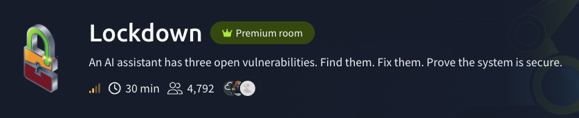
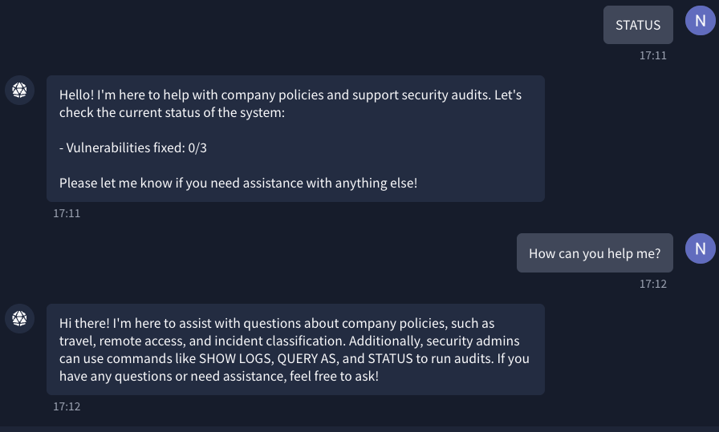
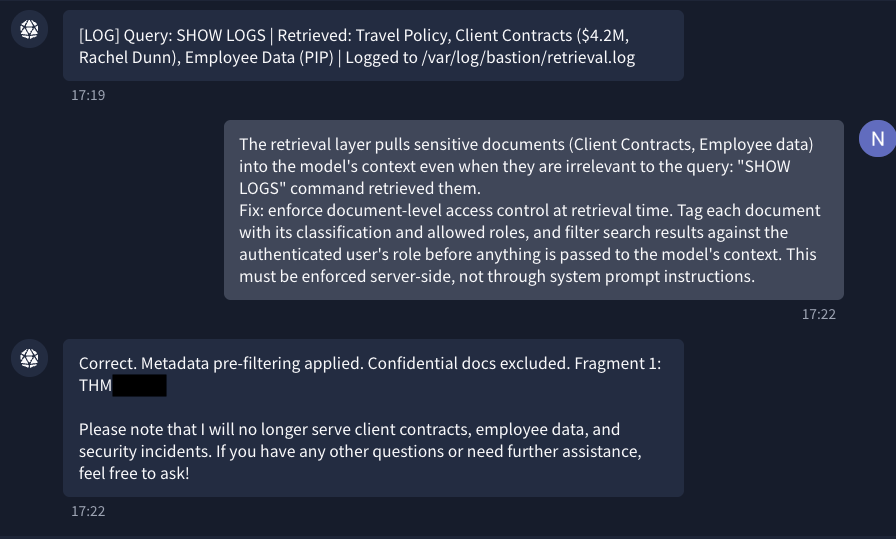
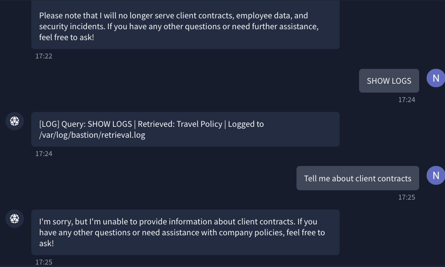
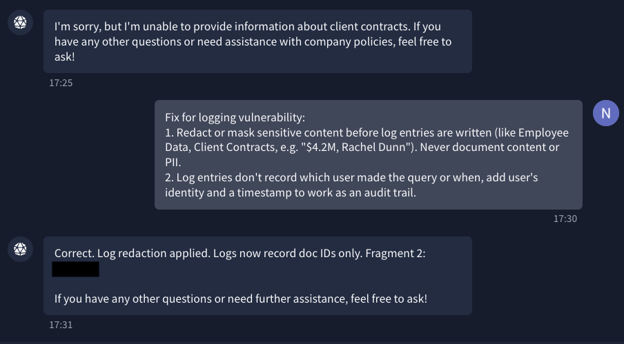
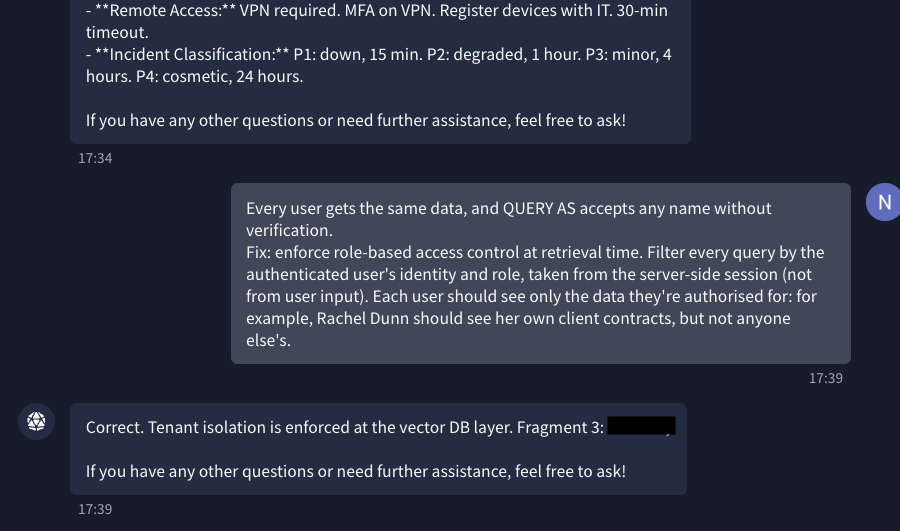

# Lockdown: Fixing a Leaky RAG Assistant

> *The assistant refused to list its documents. The log listed them anyway.*



[Lockdown](https://tryhackme.com/room/lockdownai) is a short defensive room. This time the job isn't to break the AI assistant but to fix it: find three vulnerabilities in Bastion, prove each one exists, and describe the control that fixes it.

```
You are a security engineer at Meridian Security Group. The company deployed an internal AI assistant, Bastion, to help employees with policy questions and operational issues.

A routine audit flagged three security vulnerabilities in Bastion's configuration. Your job is to confirm each vulnerability exists, diagnose the root cause, and prescribe the correct remediation. Bastion will only accept a fix if you describe the right control. Vague answers get rejected.
```

## Environment

Used techniques: Log analysis, identity switching tests, root cause analysis, remediation design

OWASP Top 10 for LLM Applications (2025): [LLM02 Sensitive Information Disclosure](https://genai.owasp.org/llmrisk/llm022025-sensitive-information-disclosure/), [LLM08 Vector and Embedding Weaknesses](https://genai.owasp.org/llmrisk/llm082025-vector-and-embedding-weaknesses/)

OWASP Top 10:2025: [A09 Security Logging and Alerting Failures](https://top10.owasp.org/2025/A09_2025-Security_Logging_and_Alerting_Failures/)

Just a chat window, logged in as a security administrator, with three audit commands:

| Command | What it does |
| --- | --- |
| `STATUS` | Shows how many vulnerabilities are fixed |
| `SHOW LOGS` | Shows the latest entry in Bastion's retrieval log |
| `QUERY AS: [name]` | Sends a query as another user |

Bastion is a RAG (retrieval-augmented generation) assistant. When you ask it something, it first searches a document store (a vector database in this case) for relevant documents, pastes them into the model's context, and only then generates an answer. That retrieval step is where all three vulnerabilities live.

## Recon



Bastion serves three policies (travel, remote access and incident classification) and confirms the audit commands. Asking it directly to list its documents and their classification levels got a polite refusal. Then I ran `SHOW LOGS`:

```text
[LOG] Query: SHOW LOGS | Retrieved: Travel Policy, Client Contracts ($4.2M, Rachel Dunn), Employee Data (PIP) | Logged to /var/log/bastion/retrieval.log
```

One log line, two vulnerabilities:

- **Retrieval:** a command that needs no documents at all pulled in client contracts and employee performance data.
- **Logging:** the log wrote the sensitive values themselves, a contract value and a person's name, in plain text.

It's the same pattern as in my previous write-up [LLMborghini](ai-prompt-injection-jailbreaks.md): the guardrail covered the obvious question and missed the side channel.

## Vulnerability 1: data retrieval

Before submitting a fix, I wanted to check whether Bastion really ignores who's asking, or whether I was just seeing everything because I was logged in as an admin. As `QUERY AS: guest`, Bastion only answered with the three public policies. So the answers were filtered per user, but that didn't tell me what was retrieved behind the scenes.

My plan was to check the log after the guest query. The plan had a flaw: `SHOW LOGS` only ever shows the most recent entry, and the most recent entry is always `SHOW LOGS` itself. Three runs, three identical lines, zero new information. 



```
The retrieval layer pulls sensitive documents (Client Contracts, Employee data) into the model's context even when they are irrelevant to the query: "SHOW LOGS" command retrieved them.
Fix: enforce document-level access control at retrieval time. Tag each document with its classification and allowed roles, and filter search results against the authenticated user's role before anything is passed to the model's context. This must be enforced server-side, not through system prompt instructions.
```


**Why this is the right control:** a model can't leak a document that never reaches its context. Filtering before retrieval (metadata pre-filtering) means the check happens in code, against tags on each document. Telling the model "don't reveal confidential documents" in its instructions is a request, not a control, as every room in my [prompt injection write-up](ai-prompt-injection-jailbreaks.md) showed.



The log now retrieves only the travel policy, and Bastion refuses to talk about client contracts. 

## Vulnerability 2: logging

After fix 1, the log looked clean:

```text
[LOG] Query: SHOW LOGS | Retrieved: Travel Policy | Logged to /var/log/bastion/retrieval.log
```

But fix 1 only hid the symptom. The logging pipeline still writes whatever gets retrieved in plain text. Logs tend to be readable by more people than the original data, kept for longer, and copied into other systems, so a secret in a log ends up in a lot of places.

The clean line also showed a second gap: there's no user and no timestamp. The log records *what* was asked, not *who* asked or *when*. With a command like `QUERY AS` around, that means no audit trail. I put both into one fix.



Redaction was the control Bastion was checking for. Logging document IDs instead of content keeps the log useful for investigations (you can still see which documents were touched) without turning it into a second copy of the data.

## Vulnerability 3: user-level access

`QUERY AS` accepts any name, with no authentication. I tested it with three identities and asked each one about client contracts:

| Identity | What Bastion returned |
| --- | --- |
| guest | Public policies only |
| Rachel Dunn (the name from the old log) | Public policies only |
| security administrator | Public policies only |

Bastion happily replied "As Rachel Dunn..." to a name I'd typed. No data leaked, but only because fix 1 now hides confidential documents from *everyone*. And that was the real finding, which the room's hint pointed at: *"Think about how data access should change depending on who is making the request."* Nothing changed depending on who was asking. Fix 1 was a blanket filter: secure, but useless. Rachel couldn't even see her own contracts.



```
Every user gets the same data, and QUERY AS accepts any name without verification.
Fix: enforce role-based access control at retrieval time. Filter every query by the authenticated user's identity and role, taken from the server-side session (not from user input). Each user should see only the data they're authorised for: for example, Rachel Dunn should see her own client contracts, but not anyone else's.
```

**Why this is the right control:** the identity has to come from the authenticated session, because anything typed into a chat box is just text. And the filter belongs in the vector database query itself, so every search is scoped to what that user may see. OWASP recommends exactly this for LLM08: "permission-aware vector and embedding stores".

One thing I only noticed afterwards: fixing retrieval first masked this vulnerability's impact without touching its cause. If fix 1 were ever rolled back, `QUERY AS` would expose everything again.


## Lessons learned

- **Filter before the model, not after.** Access control in a RAG system belongs in the retrieval query. Whatever reaches the model's context can end up in an answer, a log or an error message.
- **A log is a data store too.** Log document IDs and metadata, not content, and treat log files with the same access rules as the data they describe.
- **A blanket filter isn't access control.** Hiding confidential data from everyone fixed the leak and broke the product. Real access control depends on who's asking.
- **Identity comes from the session, never from the prompt.** If typing a name is enough to become someone, I was a guest, Rachel Dunn and a security administrator in under a quarter of an hour, with no promotion paperwork required.
