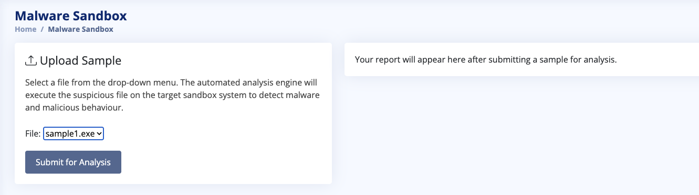
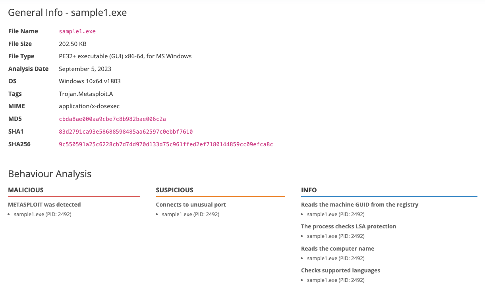
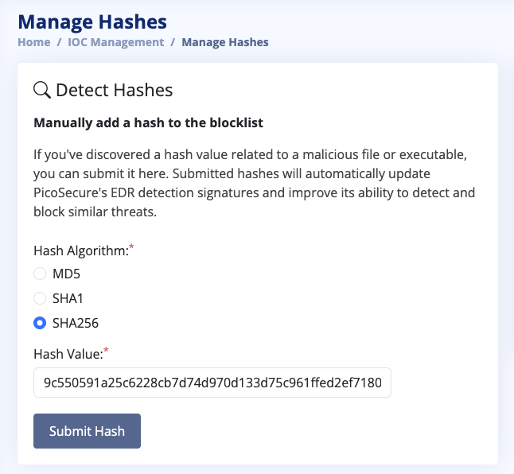
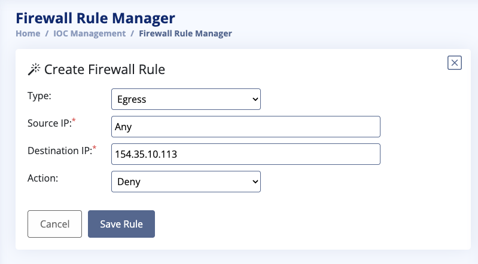
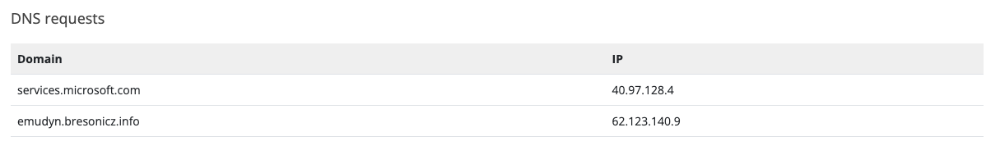
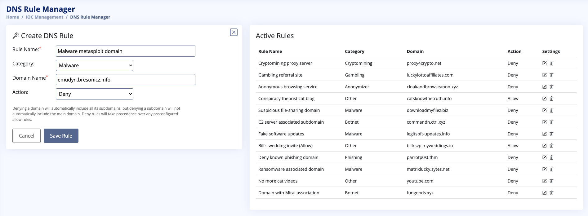
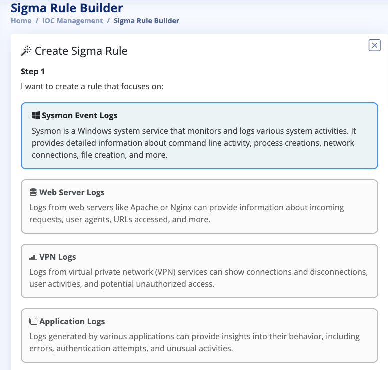
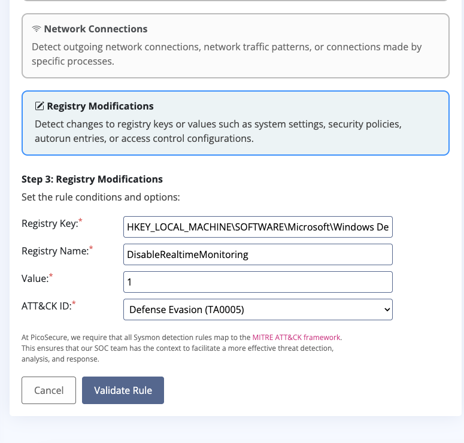
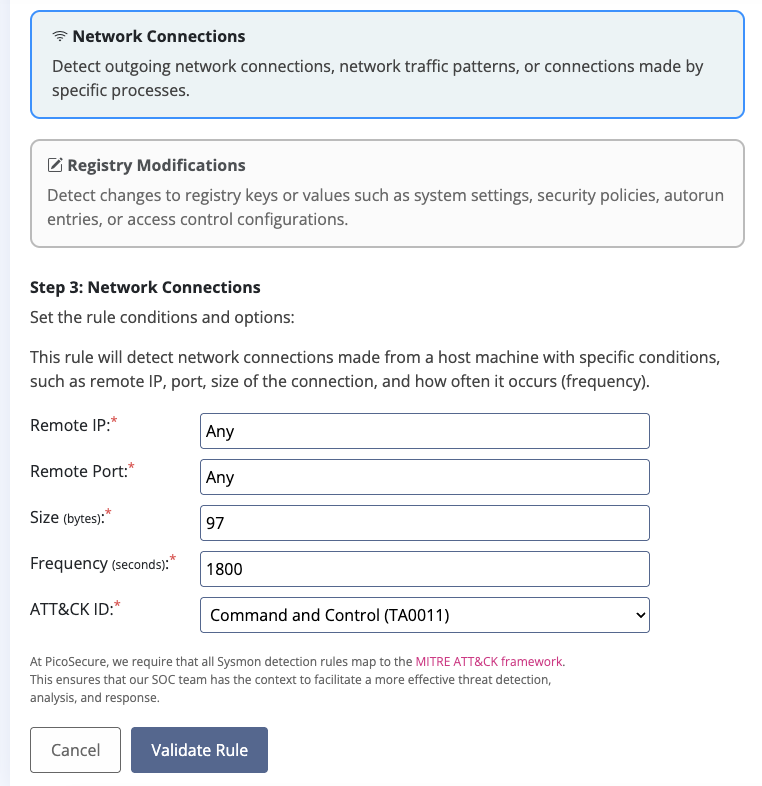
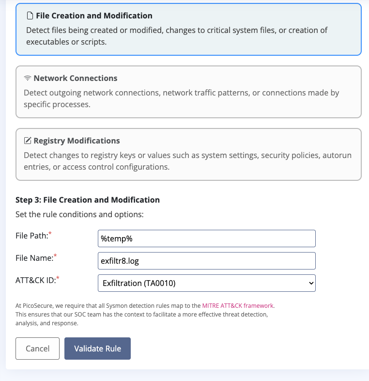

# Summit: Making an Attacker’s Life Expensive

> Six malware samples, one stubborn pentester, and a pyramid he eventually decides isn't worth climbing.


[Summit](https://tryhackme.com/room/summit) is a detection engineering room, where the task is to block attacks according to the Pyramid of Pain. The pyramid is [David Bianco's model](https://detect-respond.blogspot.com/2013/03/the-pyramid-of-pain.html) that ranks indicators of compromise by how much pain it causes the attacker when defenders deny them. It has six levels, with network and host artifacts sharing one:

1. Hash values
2. IP addresses
3. Domain names
4. Network and host artifacts
5. Tools
6. Tactics, techniques and procedures (TTPs)

Used techniques: malware sandbox analysis, hash blocking, firewall egress rules, DNS filtering, Sigma rules, beaconing detection, behavioural (TTP) analysis.

Frameworks: the Pyramid of Pain (the six levels above) for the indicator hierarchy, and [MITRE ATT&CK](https://attack.mitre.org/) for the detections, spanning [Defense Evasion (TA0005)](https://attack.mitre.org/tactics/TA0005/), [Command and Control (TA0011)](https://attack.mitre.org/tactics/TA0011/) and [Collection (TA0009)](https://attack.mitre.org/tactics/TA0009/).

The room's brief sets the scene:

> After participating in one too many incident response activities, PicoSecure has decided to conduct a threat simulation and detection engineering engagement to bolster its malware detection capabilities. You have been assigned to work with an external penetration tester in an iterative purple-team scenario. The tester will be attempting to execute malware samples on a simulated internal user workstation. At the same time, you will need to configure PicoSecure's security tools to detect and prevent the malware from executing.
>
> Following the **Pyramid of Pain's** ascending priority of indicators, your objective is to increase the simulated adversaries' cost of operations and chase them away for good. Each level of the pyramid allows you to detect and prevent various indicators of attack.

## 1. Hash values

Hash values are easy to block, and just as easy to evade. Changing even one character in a file, a comment or a newline generates a completely new hash, so a file that was blocked no longer is:

```
% echo -n "python3 -c \"print('Malicious')\"" | md5sum
ded43b4c31dcc18c7bdf2cf519dfdffd  -
% echo -n "python3 -c \"print('Maliciouss')\"" | md5sum
277ad3c9410b88100a2c9700c477cab2  -
```

That's entirely by design. Hashes are one-way functions, which is exactly what makes them good for integrity checks: you compute the hash of a file and compare it to the published checksum, and a single changed byte shows up immediately. The same sensitivity is what makes them cheap to evade as a blocklist entry.

Fuzzy hashes were designed for exactly this problem. Similar inputs produce similar hashes, and comparing two of them gives a similarity score. A recompiled or lightly patched sample can still score as a close match to the original, and VirusTotal lists both values for submitted files. They have limits, though. Packing or encrypting the payload changes most of the file, and any similarity match needs a threshold, which brings false positives with it. PicoSecure's blocklist only accepts MD5, SHA1 and SHA256, so in this room they stay a side note.

Depending on the algorithm, we also need to consider hash collisions, which occur when two different inputs produce the same hash output. MD5 and SHA1 both have practical collision attacks. These matter most for allowlisting, where a malicious file could share a hash with a trusted one and wear its hat. For blocklisting the risk is much lower, because making a new file match a hash you've already blocked (a preimage attack) still isn't practical, even for MD5.

---

> Hey there.
>
> I'm Sphinx, and I will be working with you on conducting threat simulation and detection engineering tests. I will attempt to execute malware samples on a simulated compromised user account to see if PicoSecure's security tools can detect the attacks.
>
> This will be an iterative process; as your detection methods become more sophisticated, I will upgrade my malware samples to increase the difficulty of detection.
>
> I will start with something simple, using "`sample1.exe`".
>
> Scan this file using the `Malware Sandbox` tool and review the generated report. Maybe there's a unique way for you to distinguish this file and add a detection rule to block it. Once you manage to do so, I'll be in touch again.

I ran the analysis in the malware sandbox and the file was identified as a Metasploit-based trojan. On execution, it fingerprints the host by reading the machine GUID, computer name, and supported languages, and checks whether LSA protection is enabled. The sandbox doesn't say why, but I read the LSA check as a likely precursor to credential theft.





Starting at the bottom of the pyramid, the first block targets file hashes. I submitted the SHA256 value, as it's the industry standard used in most modern tools (like VirusTotal or SIEMs). MD5 and SHA1 are more exposed to collisions, but as covered above, that matters far less for blocklisting than for allowlisting.



And with that done, let's take a step up the Pyramid of Pain.

## 2. IP addresses

An IP address is a numerical address that identifies a device on a network. Public addresses are assigned by an internet service provider or hosting company, while private ranges are reused across networks behind NAT, so an IP isn't globally unique.

Blocking it is a bit inconvenient for the attacker, however it's not a dealbreaker. If an ISP uses dynamic IP addresses, restarting the modem or router may assign a new one. More likely, the attacker doesn't use their own IP address at all (that wouldn't be very smart). They can switch to a VPN, route traffic through another compromised machine, or move to a different server or hosting provider.

It's a quick change, though, and it's still a good idea to block IP addresses that seem malicious. It won't stop a determined hacker, but it could prevent attacks aimed at low-hanging fruit.

---

> I generated a new file hash and executed it without issue. See if you can come up with a new way to detect `sample2.exe` !

Network activity: 1 HTTP(S) request, 3 TCP/UDP connections, 0 DNS requests.

| PID | Process | Method | IP | URL |
| --- | --- | --- | --- | --- |
| 1927 | sample2.exe | GET | 154.35.10.113:4444 | http://154.35.10.113:4444/uvLk8YI32 |

| PID | Process | IP | Domain | ASN |
| --- | --- | --- | --- | --- |
| 1927 | sample2.exe | 154.35.10.113:4444 | - | Intrabuzz Hosting Limited |
| 1927 | sample2.exe | 40.97.128.3:443 | - | Microsoft Corporation |
| 1927 | sample2.exe | 40.97.128.4:443 | - | Microsoft Corporation |

Like sample1, it fingerprints the host (machine GUID, computer name, supported languages) and checks LSA protection. It then calls back to `http://154.35.10.113:4444/uvLk8YI32`, a server hosted by Intrabuzz Hosting Limited. Port 4444 is Metasploit's default listener port. There are no DNS requests, so the C2 address is probably hardcoded as a bare IP, which means a domain block won't help and the IP must be blocked directly. The connections to 40.97.128.3 and 40.97.128.4 belong to Microsoft and are normal Windows traffic, not part of the attack.

The fix was quick: I created a firewall rule that denies egress (outbound) traffic to the C2 server.

Blocking outbound traffic is what matters here, because the malware initiates the connection from inside the network.



## 3. Domain names

A domain name is the human-readable label that DNS translates into an IP address. For an attacker, a domain adds a layer of indirection: the malware looks up the name each time it runs, so the attacker can move the server to a new IP by updating DNS, without touching the malware itself. That's also why blocking the domain hurts more than blocking an IP. Getting a new one means registering and paying for it, setting up DNS and updating the malware to use it. It's still not a huge barrier.

---

> This time, you'll need to detect `sample3.exe` another way. I already have my server running from a new IP address and have plenty more backups to failover in case they get blocked!

The sandbox report for sample3 looks familiar at first: the same Metasploit tag, the same host fingerprinting, the same LSA check. The difference is in the network section. This time the sample resolves a domain, `emudyn.bresonicz.info`.

| PID | Process | Method | IP | URL |
| --- | --- | --- | --- | --- |
| 1021 | sample3.exe | GET | 62.123.140.9:1337 | http://emudyn.bresonicz.info:1337/kzn293la |
| 1021 | sample3.exe | GET | 62.123.140.9:80 | http://emudyn.bresonicz.info/backdoor.exe |

The first request goes to port 1337 with a short, random-looking URI. The second downloads `backdoor.exe` over port 80, and the sandbox flags that second-stage binary as malicious in its own right, with its own connection back to the same domain.



I added a deny rule in the DNS Rule Manager under the Malware category. The list also offers Botnet, which I briefly considered because of the C2 traffic, but this is one attacker's server handing out a payload, and that's what the Malware category is for.




Blocking the domain works because the malware looks it up at runtime. Sphinx can move to as many new IPs as he likes, and the sample will still ask for `emudyn.bresonicz.info` first and get nothing back. To get around it he has to register and pay for a new domain, point DNS at it and rebuild the sample, which is the step up in cost the pyramid describes. His next message confirms it.

The form notes that denying a domain also denies its subdomains, but not the other way round. I blocked the full `emudyn.bresonicz.info`, which the room accepts. In a real environment I'd consider blocking `bresonicz.info` instead, since whoever controls one subdomain very likely controls its siblings.

## 4. Host artifacts

Host artifacts are the traces malware leaves on the system it runs on: registry keys and values, files it creates or drops, scheduled tasks, services, unusual parent-child process relationships. Network artifacts share the same level of the pyramid and cover the equivalent on the wire, such as distinctive URI patterns, user-agent strings or C2 traffic. A detection based on artifacts targets what the malware does, so a new hash, IP or domain won't get around it. The attacker has to change the malware's behaviour, which usually means going back to the lab to reconfigure or recompile their tools. Bianco calls this level Annoying.

---

> This time - blocking hashes, IPs, or domains won't help you. If you want to detect `sample4.exe`, consider what artifacts (or changes) my malware leaves on the victim's host system.

This sample's report has a Registry Activity section with three events.

| Process (PID) | Operation | Key | Name | Value |
| --- | --- | --- | --- | --- |
| sample4.exe (3806) | write | `HKLM\SOFTWARE\Microsoft\Windows Defender\Real-Time Protection` | DisableRealtimeMonitoring | 1 |
| explorer.exe (1928) | write | `HKCU\Software\Microsoft\Windows\CurrentVersion\Explorer\Advanced` | EnableBalloonTips | 1 |
| notepad.exe (9876) | read | `HKCU\Software\Microsoft\Windows\CurrentVersion\Explorer\FileExts\.txt` | Progid | txtfile |

`sample4.exe` writes `DisableRealtimeMonitoring = 1` to the Windows Defender Real-Time Protection key, which switches off Defender's real-time scanning so anything dropped afterwards runs without being checked. The other two rows are background noise.

I built the rule in the Sigma Rule Builder: Sysmon Event Logs, then Registry Modifications, with the key, the value name, a value of 1, and Defense Evasion (TA0005) as the tactic.





This rule doesn't care what the file is called, what its hash is, or where it phones home. Any sample that disables Defender through this registry value trips it, so recompiling or moving servers won't help Sphinx. He has to change how his malware gets Defender out of the way, and his reply says as much: he spent ages reconfiguring his tools and methodologies. That lines up with Bianco's description of this level as the point where the attacker has to go back to the lab.

## 5. Tools

Tools are the software an attacker relies on to get the job done, for example frameworks like Metasploit or Cobalt Strike. Detecting a tool means catching something every build of it shares, such as a distinctive communication pattern, a behaviour signature. Once a tool is reliably detected, the attacker has to find or build a replacement and then learn to use it, which costs real time and money. Bianco rates this level Challenging.

---

> Having my team develop new techniques used in my adversary tools was a time-consuming effort and a significant cost. It's good that we have a substantial budget for this engagement, but many threat actors would have given up and found a new victim by now.
>
> I finally have `sample5.exe` for you to detect. Different approach this time. In this sample, all of the "heavy lifting" and instruction occurs on my back-end server, so I can easily change the types of protocols I use and the artifacts I leave on the host. You'll have to find something unique or abnormal about the behaviour of my tool to detect it.
>
> I attached the logs of the outgoing network connections from the last 12 hours on the victim machine. That may help you correlate something.

The sandbox shows sample5 contacting `bababa10la.cn` (51.102.10.19) on port 1382 with another random URI, then downloading `beacon.bat`. From then on `beacon.bat` does the talking:

| PID | Process | Method | URL |
| --- | --- | --- | --- |
| 8374 | sample5.exe | GET | http://bababa10la.cn:1382/zz89j3uf |
| 8374 | sample5.exe | GET | https://bababa10la.cn/beacon.bat |
| 1702 | beacon.bat | POST | https://bababa10la.cn/keep-alive?hostname=WK102 |

The report counts 402 HTTP(S) requests, and the list gives up after a dozen identical keep-alive POSTs. Sphinx's 12-hour connection log shows what that looks like from the victim's side:

```
2023-08-15 09:00:00 | Source: 10.10.15.12 | Destination: 51.102.10.19 | Port: 443 | Size: 97 bytes
2023-08-15 09:23:45 | Source: 10.10.15.12 | Destination: 43.10.65.115 | Port: 443 | Size: 21541 bytes
2023-08-15 09:30:00 | Source: 10.10.15.12 | Destination: 51.102.10.19 | Port: 443 | Size: 97 bytes
2023-08-15 10:00:00 | Source: 10.10.15.12 | Destination: 51.102.10.19 | Port: 443 | Size: 97 bytes
2023-08-15 10:14:21 | Source: 10.10.15.12 | Destination: 87.32.56.124 | Port: 80  | Size: 1204 bytes
2023-08-15 10:30:00 | Source: 10.10.15.12 | Destination: 51.102.10.19 | Port: 443 | Size: 97 bytes
[...]
2023-08-15 21:00:00 | Source: 10.10.15.12 | Destination: 51.102.10.19 | Port: 443 | Size: 97 bytes
```

Most connections are irregular in timing, size and destination, which is what a person browsing looks like. The ones to 51.102.10.19 land exactly on the hour and half hour, and every one is 97 bytes. That's beaconing: the implant checks in with its C2 server on a timer, reports the hostname, and asks whether there's anything to do. Nobody browses with that kind of discipline.

The rule went into the Sigma Rule Builder under Sysmon Event Logs, then Network Connections: Remote IP and Remote Port set to Any, Size 97 bytes, Frequency 1800 seconds (30 minutes), and Command and Control (TA0011) as the tactic.



The wildcards are deliberate. Sphinx has already shown he can swap IPs and domains, and he says his backend lets him change protocols and host artifacts too. What he can't easily change is the size and rhythm of the check-in, because those come from how the tool itself is built. Real C2 frameworks usually add jitter to the interval and padding to the size to dodge exactly this kind of rule, so a fixed 97 bytes every 1800 seconds is the friendly classroom version.

## 6. Tactics, techniques and procedures

Tactics, techniques and procedures describe how an attacker operates. Tactics are the goals (discovery, collection, exfiltration), techniques are the methods used to reach them, and procedures are the specific way a particular attacker carries them out, down to their habits. MITRE ATT&CK catalogues tactics and techniques, with real-world procedure examples for each. A detection at this level works regardless of the hash, infrastructure or tool, because it targets what the attacker does with all of them. To get around it, they have to change how they work, which means unlearning habits and retraining. Bianco calls this level Tough, and by that point most attackers would rather find an easier target.

---

> You managed to detect `sample5.exe` ! I'm very impressed. But also very annoyed! Because now, I need to go back to the drawing board and create a brand new tool to do what I need to do. If I can't find another one quickly, this will be another significant investment. Also, I will need to train myself all over again on how to use it!
>
> I can keep this up one or two times, but there's no way I can continue after this. The reward no longer outweighs the cost, and I would instead find an easier target with detection capabilities much lower on the pyramid.
>
> For my last trick, I have `sample6.exe`. This time, you will need more than artifacts or tool detection to help you. You'll need to focus on something extremely hard for me to change subconsciously - my techniques and procedures.
>
> I've attached the recorded command logs from all my previous samples to understand better what actions I tend to perform on my victims to extract info once I have remote access. Good luck!

Sphinx's command log, trimmed:

```
dir c:\ >> %temp%\exfiltr8.log
dir "c:\Documents and Settings" >> %temp%\exfiltr8.log
[...]
net localgroup administrator >> %temp%\exfiltr8.log
ver >> %temp%\exfiltr8.log
systeminfo >> %temp%\exfiltr8.log
ipconfig /all >> %temp%\exfiltr8.log
netstat -ano >> %temp%\exfiltr8.log
net start >> %temp%\exfiltr8.log
```

Every command is reconnaissance. The `dir` lines map drives, user folders and installed software. `net localgroup administrator` looks for admin accounts. `ver` and `systeminfo` give the OS version, patches and hardware, `ipconfig /all` and `netstat -ano` describe the network and what the machine is talking to, and `net start` lists running services, security tools included.

Any of these could come from an IT admin on an ordinary Tuesday. The giveaway is the `>>` on every line. It appends each command's output to the same file without overwriting what's already there, so by the end `%temp%\exfiltr8.log` holds a full profile of the machine, ready to be sent home.

The sandbox confirms sample6 follows the same routine. It runs from the user's temp folder, spawns three `cmd.exe` processes, and one of them drops the file:

| PID | CMD | Path | Parent |
| --- | --- | --- | --- |
| 8374 | sample6.exe | C:\Users\admin\AppData\Local\Temp\sample6.exe | explorer.exe |
| 3992 | cmd.exe | C:\Windows\system32\cmd.exe | sample6.exe |
| 1432 | cmd.exe | C:\Windows\system32\cmd.exe | sample6.exe |
| 2312 | cmd.exe | C:\Windows\system32\cmd.exe | sample6.exe |

| PID | Process | Filename | Type |
| --- | --- | --- | --- |
| 2312 | cmd.exe | %temp%\exfiltr8.log | text |

The rule went into the Sigma Rule Builder under Sysmon Event Logs, then File Creation and Modification: File Path `%temp%`, File Name `exfiltr8.log`, and Exfiltration (TA0010) as the tactic.



About that tactic. Writing a file to the local disk is still a step before exfiltration, since nothing has left the machine yet. ATT&CK files this under Collection as [T1074.001 Data Staged: Local Data Staging](https://attack.mitre.org/techniques/T1074/001/), where collected data is gathered in one place on the local system before it's exfiltrated. The room accepts Exfiltration, presumably because that's where the file is headed, so that's what I submitted. Collection (TA0009) is the more precise fit.

Then a less comfortable thought: what stops Sphinx renaming the file to `notes.log`? Nothing. The rule matches one filename in one folder, and changing a filename costs about as much as changing a hash. Strictly speaking, this detection is a host artifact wearing a TTP badge. The room keeps it simple because the builder only takes a path and a name.

A rule aimed at the procedure itself would look for the pattern behind the filename: `cmd.exe` spawned by something running from a temp folder, several discovery commands in quick succession from the same parent, and their output appended to a file under `%temp%`.

> Well, that's it. I have officially given up.
>
> Throughout the engagement, you managed to chase me to the very top of the Pyramid of Pain, and I have to say, it's not fun up here!
>
> You detected my samples file hashes, IPs, domains, host artifacts, tools, and now my own behavioural techniques! To continue, I have no choice but to completely retrain myself and conduct extensive research to figure out how you're catching me. And with that, I don't think you'll ever see me again. Enjoy the final flag; you've earned it!

## Lessons learned

- The most useful question about any detection is what the attacker has to change to beat it. A hash costs one byte, an IP a new server, a domain a registration and a DNS change. Asking it about my own `exfiltr8.log` rule is what showed me it was a filename match dressed up as a TTP detection.
- Every report contained harmless entries, and leaving them alone was part of the job. The Microsoft connections, Explorer's balloon tips, Notepad's file association and the irregular browsing traffic all looked suspicious sitting next to malware. Blocking them would have broken things without slowing Sphinx down.
